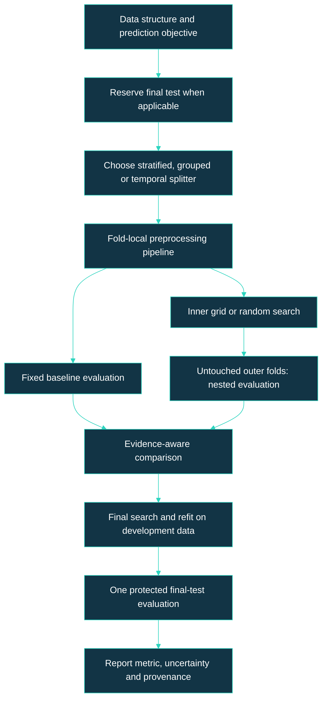

<p align="center">
  <a href="https://astounding-marzipan-63764d.netlify.app/"></a>
  <a href="https://astonishing-dodol-818e9f.netlify.app/"></a>
  <a href="https://lively-halva-00f14e.netlify.app/"></a>
  <a href="https://taupe-tarsier-591729.netlify.app/"></a>
</p>

# [Model Validation & Hyperparameter Optimization](): [Cross-Validation, Nested CV, Grid Search, Random Search & AutoML]()

🎯 Data Science & AI/ML → Model Evaluation, Benchmarking & Selection → Classes 06–09

Institution: Pontifical Catholic University of São Paulo (PUC-SP)  <br>
School: FACEI — Computer Science Department  <br>
Course: BSc in Human-Centered AI & Data Science · 6th Semester · 2026  <br>
Subject: Data Science & Machine Learning — Model Evaluation, Benchmarking & Selection  <br>
Extensionist Projects: Social projects with open-source software for community support  <br>
Professor: ✨ Giovani Giulio Tristão Thibes Vieira  <br>
Author: Fabiana ⚡️ Campanari

<br><br>

## [Table of Contents]()

1. [Repository Identity](#repository-identity)
2. [Overview](#overview)
3. [Source Provenance and Evidence](#source-provenance-and-evidence)
4. [Learning Path](#learning-path)
5. [Cross-Validation and Splitter Selection](#cross-validation-and-splitter-selection)
6. [Nested Cross-Validation](#nested-cross-validation)
7. [Grid Search and the Music Laboratory](#grid-search-and-the-music-laboratory)
8. [Random Search and AutoML](#random-search-and-automl)
9. [Mathematical Foundations](#mathematical-foundations)
10. [Integrated Conceptual Workflow](#integrated-conceptual-workflow)
11. [Source-Reported Results](#source-reported-results)
12. [Reference Implementation and Usage](#reference-implementation-and-usage)
13. [Repository Contents and Presentation](#repository-contents-and-presentation)
14. [Limitations and Responsible Practice](#limitations-and-responsible-practice)
15. [References](#references)
16. [Conclusion](#conclusion)

## [Repository Identity]()

Suggested name: `ai-ml-model-validation-and-hyperparameter-optimization`.

About (under 160 characters):

> Cross-validation, nested CV, grid/random search and AutoML: leakage-safe evaluation, hyperparameter selection and interactive class presentations.

Suggested topics: `machine-learning`, `data-science`, `python`, `scikit-learn`, `cross-validation`, `nested-cross-validation`, `grid-search`, `random-search`, `automl`, `model-selection`, `model-evaluation`, `hyperparameter-optimization`.

This is a multi-class repository covering Classes 06–09, not Class 13. The Class 07 source contains inconsistent Class 13 badges and naming; its module identity here follows its title and referenced Class 07 notebook. No GitHub repository has been created remotely.

<br><br>

## [Overview]()

This integrated learning repository connects four complementary questions:

1. How should data be split to evaluate a fixed learning workflow? Cross-validation.
2. How can a tuned workflow be evaluated without reusing the evidence that selected it? Nested CV.
3. How can hyperparameters be selected systematically in a small space? Grid Search.
4. How can larger spaces be explored under a controlled budget, and what can be automated? Random Search and AutoML.

The organizing principle is: training learns, validation chooses, and independent evaluation audits that choice. Consolidating the lessons does not merge their datasets or make their scores directly comparable.

<br><br>

## [Source Provenance and Evidence]()

The authoritative materials for this consolidation are the four uploaded READMEs, not newly inspected original PDFs, CSVs, or notebooks. Statements that a notebook implemented or demonstrated something are preserved as source-reported statements, not independently rerun verification.

| Module | Supplied README | Status in this package |
|---|---|---|
| Class 06 — Cross-validation | `5-class6README.md` | Original copied into `docs/modules/` |
| Class 07 — Nested CV | `5-class7README.md` | Original copied; identity inconsistency documented |
| Class 08 — Grid Search | 35,138-byte `5-README.md` | Curated extract; original unavailable under colliding local filename |
| Class 09 — Random Search and AutoML | 31,185-byte `5-README.md` | Original copied; code explicitly reference-only |

Two files had the same filename. The extraction system distinguished their source IDs, but the local filesystem exposed only the Class 09 version. The Class 08 module is therefore a reconstruction of extracted content, not an exact archival copy.

Evidence labels:

- Source-reported demonstration: described as executed in a supplied README, not rerun here.
- Conceptual: explanatory material or architecture.
- New reference implementation: code written for this integrated repository, not original class code.
- Recommended / future: a proposed improvement, not an implemented class feature.

All four presentation URLs were supplied by the author. Retrieval failed during preparation; no claim of current availability or frontend technology verification is made.

<br><br>

## [Learning Path]()


| Order | Module | Main tools | Main outcome |
|---|---|---|---|
| 1 | [Class 06](docs/modules/class-06-cross-validation.md) | `cross_val_score`, KFold, stratified, repeated, group and temporal splitters | A data-appropriate validation scheme |
| 2 | [Class 07](docs/modules/class-07-nested-cv.md) | SVC pipeline, inner GridSearchCV, outer StratifiedKFold | Audit of the complete selection process |
| 3 | [Class 08](docs/modules/class-08-grid-search.md) | Logistic Regression, GridSearchCV, Average Precision | Systematic tuning with a protected final test |
| 4 | [Class 09](docs/modules/class-09-random-search-automl.md) | RandomizedSearchCV and sampling distributions; conceptual AutoML | Budgeted search and automation boundaries |
Class 07 precedes Class 08 pedagogically: nested evaluation is an evaluation design, while the later grid-search laboratory studies the search mechanism in a different task.

<br><br>

## [Cross-Validation and Splitter Selection]()

Cross-validation fits fresh estimators across training/validation rotations and aggregates held-out scores. The correct splitter must resemble the intended prediction setting.

| Data structure | Relevant splitter | What it protects |
|---|---|---|
| Independent observations | KFold | Multiple development partitions |
| Classification with class imbalance | StratifiedKFold | Approximate class proportions |
| Repeated measurements of entities | GroupKFold | Entities remain disjoint across train/validation |
| Ordered observations predicting the future | TimeSeriesSplit | Training precedes validation |
| Repeated shuffled classification estimates | RepeatedStratifiedKFold | Multiple viable fold assignments |
| Very small dataset | LeaveOneOut, when justified | One observation held out per round |

Stratification does not create rare-class observations. Choosing the number of folds should account for the least frequent class and the requirements of the scoring metric. Group and temporal examples must use genuine groups and timestamps, not invented fields.

Fold-score standard deviation describes dispersion across the observed folds. It is not automatically a standard error or a confidence interval: folds share training data and are not independent measurements.

<br><br>

## [Nested Cross-Validation]()

Selecting the largest among noisy validation scores creates selection optimism, called the winner’s curse in the Class 07 material. `best_score_` is a selection statistic, not an independent generalization estimate.

In each outer round:

1. Keep the outer validation fold completely outside tuning.
2. Run an inner search on the outer training partition.
3. Refit the selected pipeline on that training partition.
4. Score the pipeline on the untouched outer fold.

Aggregate the outer scores to evaluate the selection-and-training procedure. Different outer rounds may select different hyperparameters; nested CV does not produce a uniquely privileged final model. After auditing, run the chosen search on all development data for the final fitted estimator. Keep a final holdout protected if one is part of the protocol.

<br><br>

## [Grid Search and the Music Laboratory]()

Class 08 reports a music-hit classifier using `5_musicas.csv`, with approximately 12.2% positives. The target is `hit`. Identifiers and `popularidade` are removed; the source identifies popularity as leakage because it almost determines the target.

The reported pipeline combines StandardScaler and LogisticRegression. It searches:

```python
grid = {
    "clf__C": [0.01, 0.1, 1, 10, 100],
    "clf__class_weight": [None, "balanced"],
}
```

Ten candidates with five folds require 50 CV fits, plus the final refit when enabled. Hyperparameter names use `step__parameter` to address the pipeline classifier.

The original workflow uses `pd.get_dummies` before the train/test split. This is documented rather than silently rewritten as fold-local encoding. Recommended improvement: use a fitted encoder inside a ColumnTransformer/Pipeline, with explicit unseen-category handling. The source’s scaler is already inside the pipeline.

<br><br>

## [Random Search and AutoML]()

👩🏻‍🚀👩🏻‍🚀👩🏻‍🚀👩🏻‍🚀

RandomizedSearchCV samples configurations rather than exhaustively enumerating a grid. `n_iter` controls the candidate budget; folds still multiply its computational cost.

| Parameter type | Search representation | Example |
|---|---|---|
| Integer | SciPy `randint` | Tree depth or minimum leaf samples |
| Linear continuous | SciPy `uniform` | A bounded fraction; scale means interval width |
| Positive, orders of magnitude | SciPy `loguniform` | Regularization or learning rate |
| Categorical | A list | Class weights or algorithm options |

Bayesian optimization uses preceding evaluations to guide subsequent trials; it is conceptual context here. AutoML can automate portions of preprocessing, candidate selection, tuning and ensembling, depending on the tool. No particular AutoML service, production deployment or monitoring platform is established by these source materials.

Automation does not determine target validity, leakage, stakeholder error costs, privacy requirements or fairness. Those remain explicit design responsibilities.

<br><br>

## [Mathematical Foundations]()

For fold scores \(s_1,\ldots,s_K\), use the source notebooks’ population-form dispersion:

\[
\bar{s}=\frac{1}{K}\sum_{k=1}^{K}s_k,\qquad
\sigma=\sqrt{\frac{1}{K}\sum_{k=1}^{K}(s_k-\bar{s})^2}.
\]

For \(G\) grid candidates:

\[
G=\prod_j m_j,\quad
N_{\mathrm{grid,CV}}=GK_{\mathrm{inner}},\quad
N_{\mathrm{nested,CV}}=GK_{\mathrm{inner}}K_{\mathrm{outer}}.
\]

These count candidate-validation fits only. With refit enabled, each outer search adds one training-partition refit; a separate final search adds its own CV fits and refit. Random search replaces \(G\) by the sampled candidate count.

If a promising region has sampling probability \(p\), independent random trials give:

\[
P(\text{at least one promising trial})=1-(1-p)^n.
\]

The quantity is a coverage model, not measured accuracy and not a guarantee of finding an optimum.

Average Precision (AP) summarizes precision at recall increments:

\[
AP=\sum_n(R_n-R_{n-1})P_n.
\]

AP is not identical to every trapezoidal precision–recall area implementation. Do not compare AP with accuracy as if they measured the same thing.

<br><br>

## [Integrated Conceptual Workflow]()



This is a conceptual consolidation, not a production architecture or a claim that every class executes every stage.

<br><br>

## [Source-Reported Results]()

| Module | Experiment / metric | Source-reported result | Interpretation |
|---|---|---|---|
| 06 | Logistic Regression accuracy, 5-fold | 0.8938 ± 0.0117 | Development estimate in that lab |
| 06 | Logistic Regression accuracy, 10-fold | 0.8938 ± 0.0286 | Same mean, different observed dispersion |
| 06 | Repeated stratified accuracy, 50 scores | 0.8944 ± 0.0131 | Repeated fold assignments |
| 07 | SVC best internal accuracy | 0.8633 | Selection-stage statistic |
| 07 | Nested outer accuracy | 0.8467 ± 0.0600 | External selection-process audit |
| 08 | Logistic Regression internal AP | 0.7207 | Search-stage statistic |
| 08 | Protected test AP / ROC AUC | 0.7116 / 0.9296 | Independent final test in source |
| 09 | Original reproducible experiment | Not provided | Do not fill in a synthetic class result |

These values are transcribed from the uploaded READMEs and have not been reproduced in this package. Different datasets, models, splits and metrics prevent interpreting this table as a cross-class performance ranking.

Class 07’s 9×5×5=225 fit count excludes outer refits. Class 08’s 10 of 10 candidates within a champion’s one-standard-deviation band is a descriptive plateau, not a significance test or confidence statement.

<br><br>

## [Reference Implementation and Usage]()

The package includes `src/reference_workflow.py`: a newly written educational implementation, not original notebook code. It generates an explicitly synthetic imbalanced binary dataset; numeric synthetic labels are 0/1. It evaluates a fixed logistic baseline, performs nested grid or random search, fits the final search on development data, and evaluates the protected holdout once per execution.

The same dataset makes the two search strategies comparable as a new reference experiment, but these outputs must not be presented as classroom results. Repeatedly using the final holdout to choose the method would violate its protected role.

```bash
python -m venv .venv
# macOS / Linux
source .venv/bin/activate
# Windows PowerShell: .venv\Scripts\Activate.ps1
pip install -r requirements.txt
python -m src.reference_workflow --method grid
# Alternative separate demonstration:
python -m src.reference_workflow --method random
```

Dependencies are numpy, scipy and scikit-learn. This package does not establish the original classroom environment or pin unverified historical versions. Record the versions from your successful run for reproducibility. No API keys or environment variables are required.

Generated output: `artifacts/grid-reference.json` or `artifacts/random-reference.json`. It contains baseline, internal selection, nested external and holdout scores in separate fields. Python syntax was checked; training was not executed when preparing the package.

Complete copy/paste source follows:

```python
"""New reference example; synthetic data, not a reproduced classroom experiment."""
import argparse
import json
from pathlib import Path
import numpy as np
from scipy.stats import loguniform
from sklearn.datasets import make_classification
from sklearn.linear_model import LogisticRegression
from sklearn.metrics import average_precision_score, roc_auc_score
from sklearn.model_selection import (GridSearchCV, RandomizedSearchCV,
    StratifiedKFold, cross_val_score, train_test_split)
from sklearn.pipeline import Pipeline
from sklearn.preprocessing import StandardScaler


def run(method="grid"):
    X, y = make_classification(n_samples=600, n_features=12,
        n_informative=6, n_redundant=2, weights=[0.85, 0.15], random_state=42)
    X_dev, X_test, y_dev, y_test = train_test_split(
        X, y, test_size=0.2, stratify=y, random_state=42)
    pipe = Pipeline([("scale", StandardScaler()),
        ("model", LogisticRegression(max_iter=2000, random_state=42))])
    inner = StratifiedKFold(n_splits=4, shuffle=True, random_state=43)
    outer = StratifiedKFold(n_splits=5, shuffle=True, random_state=44)
    if method == "grid":
        search = GridSearchCV(pipe, {"model__C": [0.01, 0.1, 1, 10, 100],
            "model__class_weight": [None, "balanced"]},
            scoring="average_precision", cv=inner, n_jobs=1)
    else:
        search = RandomizedSearchCV(pipe,
            {"model__C": loguniform(1e-2, 1e2),
             "model__class_weight": [None, "balanced"]}, n_iter=20,
            scoring="average_precision", cv=inner, n_jobs=1, random_state=42)
    baseline = cross_val_score(pipe, X_dev, y_dev,
        cv=outer, scoring="average_precision", n_jobs=1)
    nested = cross_val_score(search, X_dev, y_dev,
        cv=outer, scoring="average_precision", n_jobs=1)
    search.fit(X_dev, y_dev)
    scores = search.best_estimator_.predict_proba(X_test)[:, 1]
    report = {
        "status": "new reference experiment on synthetic data",
        "method": method,
        "baseline_cv_ap_mean": float(np.mean(baseline)),
        "baseline_cv_ap_std_ddof0": float(np.std(baseline)),
        "nested_cv_ap_mean": float(np.mean(nested)),
        "nested_cv_ap_std_ddof0": float(np.std(nested)),
        "nested_outer_scores": nested.tolist(),
        "best_internal_cv_ap": float(search.best_score_),
        "best_params": search.best_params_,
        "holdout_ap": float(average_precision_score(y_test, scores)),
        "holdout_roc_auc": float(roc_auc_score(y_test, scores)),
    }
    output = Path("artifacts")
    output.mkdir(exist_ok=True)
    (output / f"{method}-reference.json").write_text(
        json.dumps(report, indent=2), encoding="utf-8")
    print(json.dumps(report, indent=2))
    return report


if __name__ == "__main__":
    parser = argparse.ArgumentParser()
    parser.add_argument("--method", choices=["grid", "random"], default="grid")
    run(parser.parse_args().method)
```

<br><br>

## [Repository Contents and Presentation]()

```text
ai-ml-model-validation-and-hyperparameter-optimization/
├── README.md
├── README_MASTER.md
├── requirements.txt
├── .gitignore
├── repository-metadata.json
├── docs/modules/
│   ├── class-06-cross-validation.md
│   ├── class-07-nested-cv.md
│   ├── class-08-grid-search.md
│   └── class-09-random-search-automl.md
├── src/
│   ├── __init__.py
│   └── reference_workflow.py
└── presentation/
    └── index.html
```

The new bilingual presentation is a single HTML file with embedded slide data and a no-dependency fallback. It attempts to load React from a CDN using plain JavaScript and `React.createElement`, not untranspiled JSX. When React cannot load, the native-JavaScript fallback still renders the content and controls. React mode requires internet; offline mode is explicitly not React.

Controls: keyboard arrows/space, Home, language toggle, theme toggle, SVG home/fullscreen controls, swipe, and clickable slide progress indicators. No fabricated PowerPoint download is provided. If a preview environment blocks JavaScript, open the downloaded file in a normal browser. External presentation links remain separate resources, not copied deployments.

<br><br>

## [Limitations and Responsible Practice]()

- Original PDFs, CSVs and notebooks were not supplied for this consolidation; source-reported results cannot be independently reproduced from those artifacts here.
- Dataset provenance, collection permissions, licensing and feature dictionaries remain unknown where the source does not provide them.
- Nested CV increases computational cost and cannot repair wrong splitters, target leakage, or an already-used final test set.
- Group and temporal validation must match the actual prediction scenario; stratification alone does not enforce those boundaries.
- Inspect variability and computational cost before selecting an apparently superior champion.
- New deployment, registry, explainability, fairness checks, experiment tracking and retraining governance are recommended future work, not existing class implementations.
- No code from the original source is silently reclassified as tested production software; source module files are retained for audit, including their original inconsistencies.

Recommended tests: group disjointness, chronological order, fold-local transformer fitting, label validity, minimum class counts, output schema, and end-to-end reference workflow execution. These tests are not claimed as implemented in this package.

<br><br>

## [References]()

Primary sources: the four module READMEs supplied for Classes 06–09. Source files and the Class 08 reconstruction are linked in Learning Path.

Supporting documentation:

- [scikit-learn: cross-validation](https://scikit-learn.org/stable/modules/cross_validation.html)
- [scikit-learn: GridSearchCV](https://scikit-learn.org/stable/modules/generated/sklearn.model_selection.GridSearchCV.html)
- [scikit-learn: RandomizedSearchCV](https://scikit-learn.org/stable/modules/generated/sklearn.model_selection.RandomizedSearchCV.html)
- [scikit-learn: Pipeline](https://scikit-learn.org/stable/modules/generated/sklearn.pipeline.Pipeline.html)
- [scikit-learn: Average Precision](https://scikit-learn.org/stable/modules/generated/sklearn.metrics.average_precision_score.html)
- Bergstra, J. & Bengio, Y. (2012). [Random Search for Hyper-Parameter Optimization](https://jmlr.org/papers/v13/bergstra12a.html). JMLR 13, 281–305.

Documentation links are contextual references, not evidence that an original class environment was reproduced.

<br><br>

## [Conclusion]()

The four lessons establish a coherent progression from evaluating a fixed pipeline to auditing and optimizing a complete model-selection procedure. Correct splitters protect the intended prediction scenario; nested evaluation separates choosing from measuring; grid and random search allocate compute differently; AutoML accelerates portions of experimentation without removing scientific responsibility.

This package implements documentation consolidation, a source-aware bilingual presentation, and a new synthetic reference workflow. Reproducing the original labs requires the original datasets and notebooks, which should be added with provenance and environment records before claiming verified classroom reproduction.

<br><br>

<p align="center"><a href="https://github.com/Mindful-AI-Research"></a></p>
