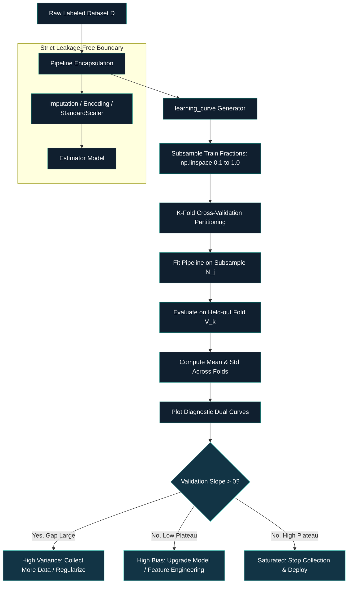

# 🎯 [Data Science & AI/ML]() ⥂ [Model Evaluation, Benchmarking & Selection]() ➝ [Class 11]() ➝ [Learning Curves]()

[**Institution:**]() Pontifical Catholic University of São Paulo (PUC-SP) <br>
[**School:**]() FACEI — Computer Science Department <br>
[**Course:**]() BSc in Human-Centered AI & Data Science • 6th Semester • 2026 <br>
[**Subject:**]() Data Science & Machine Learning — Model Evaluation, Benchmarking & Selection <br>
[**Extensionist Projects:**]() Social projects with open-source software for community support <br>
**Professor:** [✨ Giovani Giulio Tristão Thibes Vieira]() <br>
**Author:** [Fabiana ⚡️ Campanari]()

<br><br>

<p align="center">


</p>

> **Class Context:** This master documentation synthesizes Class 11 (*Curvas de Aprendizado: Vale a pena coletar mais dados?*) from the Human-Centered AI & Data Science curriculum. It formalizes empirical sample complexity diagnostics, bias-variance identification, and data acquisition ROI analysis.

---

## [Table of Contents]()

1. [Repository Identity](#repository-identity)
2. [Source Audit and Class Context](#source-audit-and-class-context)
3. [Overview and Core Problem](#overview-and-core-problem)
4. [Learning Curves vs. Validation Curves](#learning-curves-vs-validation-curves)
5. [Mathematical Foundations and Asymptotic Theory](#mathematical-foundations-and-asymptotic-theory)
6. [Detailed Technical Explanations of Core Concepts](#detailed-technical-explanations-of-core-concepts)
7. [Empirical Sample Scaling Economics](#empirical-sample-scaling-economics)
8. [Master Decision Matrix](#master-decision-matrix)
9. [Architecture and ML Pipeline](#architecture-and-ml-pipeline)
10. [Executable Code Implementation](#executable-code-implementation)
11. [Common Pitfalls and Best Practices](#common-pitfalls-and-best-practices)
12. [Technology Stack](#technology-stack)
13. [Installation and Usage](#installation-and-usage)
14. [References](#references)
15. [Conclusion](#conclusion)

## [Repository Identity]()

| Field | Value |
|---|---|
| Repository name | `class-11-ai-ml-learning-curves` |
| GitHub About | Diagnostic learning curves for sample complexity analysis, bias-variance tradeoff, and data collection decision-making. |
| Topics | `machine-learning`, `data-science`, `model-evaluation`, `learning-curve`, `bias-variance-tradeoff`, `cross-validation`, `scikit-learn` |
| Lesson | Class 11 — Learning Curves: Is It Worth Collecting More Data? |
| Ecosystem | Human Understanding (HU) / AI & Machine Learning Course Series |

## [Source Audit and Class Context]()

| Resource | Inspection Status | Scope / Role |
|---|---|---|
| `class_11-Learning-Curves-is-it-worth-collecting-more-data.mp4` | Analyzed primary audio/video recording and presentation slides. | Authoritative basis for curriculum, taxonomy, decision rules, and examples. |
| Slide Deck: *Ciência de Dados 1 · Curvas de Aprendizado (Aula 11)* | Verified via video frames. | Core structure: definition, bias/variance signatures, sample scaling table, scikit-learn API, common pitfalls. |
| Prior Lessons (Class 06–10) | Cross-referenced for continuity. | Class 10 focused on Validation Curves (hyperparameter sensitivity); Class 11 focuses on Learning Curves (sample size sensitivity). |

### Status Conventions
- **Implemented / Demonstrated:** Explicitly taught and demonstrated in the Class 11 lecture video and slide deck.
- **Conceptual:** Theoretical diagnostic frameworks and business decision economics.
- **Recommended:** Engineering and MLOps best practices for production experimentation.

## [Overview and Core Problem]()

In applied machine learning engineering, one of the most critical and expensive capital allocation decisions is determining **when a model will benefit from collecting additional training data** versus **when the model architecture itself is the fundamental bottleneck**. Data acquisition, domain expert annotation, and cloud compute scale multiplicatively. Without formal empirical diagnostics, engineering teams risk two severe failure modes:

1. **The High-Bias Data Acquisition Trap:** Allocating substantial budget to collect and label thousands or millions of additional records when the underlying model family lacks the representational capacity (*underfitting*) to absorb the information.
2. **Premature Data Collection Termination:** Stopping data collection prematurely when an estimator with high variance is actively benefiting from larger sample sizes, leaving significant generalization performance uncaptured.

**Learning Curves** solve this problem by empirically evaluating an estimator's training and out-of-fold validation performance as a mathematical function of **training dataset size** ($N$), providing concrete visual and quantitative evidence for data collection return on investment (ROI).

## [Learning Curves vs. Validation Curves]()

A common point of confusion in model evaluation is conflating **Validation Curves** with **Learning Curves**. Both compare training and validation performance, but they explore completely different operational dimensions and answer distinct engineering questions:

| Dimension | Validation Curve (Class 10) | Learning Curve (Class 11) |
|---|---|---|
| **Horizontal Axis ($X$)** | Single hyperparameter value (e.g., tree depth $d$, regularization $C$, kernel coefficient $\gamma$) | Number of training examples ($N$ or fractional percentage of available training records) |
| **Fixed Factor** | Training dataset size ($N$ held constant across all evaluations) | Model hyperparameter configuration (model architecture held fixed) |
| **Core Diagnostic Question** | What is the optimal model capacity or regularization strength? | Does the estimator have enough samples to constrain variance, or is it capacity-limited? |
| **Engineering Decision** | Hyperparameter optimization, architecture selection, model tuning | Data acquisition budget, labeling prioritization, sample size sizing, compute allocation |
| **scikit-learn Module** | `sklearn.model_selection.validation_curve` | `sklearn.model_selection.learning_curve` |

## [Mathematical Foundations and Asymptotic Theory]()

### 1. Empirical Formulation
Let the full available labeled training set be denoted by $\mathcal{D} = \{(x_i, y_i)\}_{i=1}^M$, where $x_i \in \mathbb{R}^d$ represents the feature vector and $y_i \in \mathcal{Y}$ represents the ground-truth target.

We evaluate an ordered discrete sequence of $S$ sample sizes:
$$
N_1 < N_2 < \dots < N_S \le M
$$

For a $K$-fold cross-validation scheme, the dataset $\mathcal{D}$ is partitioned into $K$ disjoint subsets $\{V_k\}_{k=1}^K$, with corresponding training partitions $T_k = \mathcal{D} \setminus V_k$. For each sample size $N_j$ and each fold $k \in \{1, \dots, K\}$, a sub-sampled training partition $T_{k, N_j} \subset T_k$ of cardinality $|T_{k, N_j}| = N_j$ is drawn.

The estimator is trained exclusively on this sub-sample:
$$
f_{N_j, k} = \operatorname*{arg\,min}_{f \in \mathcal{H}} \left( \frac{1}{N_j}\sum_{(x_i, y_i) \in T_{k, N_j}} \mathcal{L}\left(f(x_i), y_i\right) + \Omega(f) \right)
$$
where $\mathcal{L}(\cdot)$ is the task-specific loss function, $\mathcal{H}$ is the hypothesis class, and $\Omega(f)$ is a regularization penalty.

### 2. Metric Computation Across Folds
For an arbitrary evaluation metric $\mathcal{M}(f, \mathcal{S})$ (e.g., ROC-AUC, Average Precision, Negative Log-Loss, Accuracy):

1. **Fold Training Score:**
$$
s_{\mathrm{train}, k}(N_j) = \mathcal{M}\left(f_{N_j, k}, T_{k, N_j}\right)
$$

2. **Fold Validation Score (Held-Out):**
$$
s_{\mathrm{val}, k}(N_j) = \mathcal{M}\left(f_{N_j, k}, V_k\right)
$$

The sample mean performance trajectories across the $K$ cross-validation splits are:
$$
\bar{s}_{\mathrm{train}}(N_j) = \frac{1}{K}\sum_{k=1}^K s_{\mathrm{train}, k}(N_j)
$$
$$
\bar{s}_{\mathrm{val}}(N_j) = \frac{1}{K}\sum_{k=1}^K s_{\mathrm{val}, k}(N_j)
$$

The descriptive standard deviation across validation folds is computed as:
$$
\sigma_{\mathrm{val}}(N_j) = \sqrt{\frac{1}{K}\sum_{k=1}^K \left(s_{\mathrm{val}, k}(N_j) - \bar{s}_{\mathrm{val}}(N_j)\right)^2}
$$

### 3. Generalization Gap and Asymptotic Limits
The empirical generalization gap at sample size $N_j$ is defined as:
$$
\Delta(N_j) = \bar{s}_{\mathrm{train}}(N_j) - \bar{s}_{\mathrm{val}}(N_j)
$$

Under statistical learning theory, as $N_j \to \infty$:
$$
\lim_{N_j \to \infty} \Delta(N_j) = 0
$$
$$
\lim_{N_j \to \infty} \bar{s}_{\mathrm{val}}(N_j) = s^*_{\mathcal{H}} = \mathcal{M}\left(f^*_{\mathcal{H}}\right)
$$
where $s^*_{\mathcal{H}}$ represents the optimal achievable score within the hypothesis class $\mathcal{H}$, bounded above by the Bayes optimal performance $s^*_{\mathrm{Bayes}}$:
$$
s^*_{\mathrm{Bayes}} - s^*_{\mathcal{H}} = \text{Approximation Error (Bias)}
$$

## [Detailed Technical Explanations of Core Concepts]()

### 1. Generalization Trajectory Dynamics
- **What It Is:** The characteristic pattern where training score starts high and slightly decreases, while validation score starts low and increases toward a shared plateau.
- **How It Works:** When $N$ is small, a parameterized model easily memorizes the few training points ($s_{\mathrm{train}} pprox 1.0$), but fails to generalize to unseen test folds ($s_{\mathrm{val}}$ is low). As $N$ expands, rote memorization becomes impossible; the model is forced to learn true underlying statistical regularities, slightly reducing $s_{\mathrm{train}}$ while driving $s_{\mathrm{val}}$ upward.
- **Why It Matters:** Demonstrates that a drop in training score as dataset size increases is healthy and expected—not a sign of model degradation.
- **When It Is Useful:** Validating that training routines and loss functions are functioning properly during sample scaling experiments.
- **Limitations:** If the training score drops abruptly below task-acceptable levels at small $N$, the optimization algorithm may be failing to converge.
- **Component Relationship:** Governs the narrowing of the generalization gap $\Delta(N)$ before convergence.

---

### 2. High Bias (Underfitting) Signature
- **What It Is:** An asymptotic regime where both training and validation curves converge early to an unacceptably low score plateau with a negligible gap $\Delta(N) pprox 0$.
- **How It Works:** The model's hypothesis space $\mathcal{H}$ is too restrictive (or informative features are absent), preventing the model from fitting the true data-generating distribution even on training data.
- **Why It Matters:** Proves conclusively that **collecting more data will not improve performance**. The bottleneck is representation, not sample volume.
- **When It Is Useful:** Preventing costly, wasteful data collection campaigns proposed by stakeholders who believe "more data always fixes ML models".
- **Limitations:** A low score plateau can occasionally result from extreme label noise rather than model inflexibility; data quality audits must accompany this diagnosis.
- **Component Relationship:** Resolved upstream by feature engineering, increasing model complexity (e.g., switching from linear models to GBDTs/neural networks), or reducing regularization penalties.

---

### 3. High Variance (Overfitting) Signature
- **What It Is:** An asymptotic regime characterized by a high training score, a substantially lower validation score (large gap $\Delta(N) \gg 0$), and a **positive validation slope** ($rac{dar{s}_{\mathrm{val}}}{dN} > 0$) at the maximum available $N$.
- **How It Works:** The model has sufficient capacity to capture complex interactions, but the number of available observations is insufficient to tightly constrain all free parameters, leading to variance across sample draws.
- **Why It Matters:** Serves as empirical proof that **investing in additional training data will directly yield performance gains**.
- **When It Is Useful:** Justifying data collection budgets, active learning initiatives, or synthetic data generation pipelines.
- **Limitations:** If acquiring additional data is impossible or cost-prohibitive, high variance must be mitigated through inductive bias (regularization, dropout, pruning).
- **Component Relationship:** Directly connected to model regularization and feature selection strategies.

---

### 4. Saturated Learning Regime (Diminishing Marginal Returns)
- **What It Is:** The state where the validation curve has reached a flat horizontal slope ($rac{dar{s}_{\mathrm{val}}}{dN} pprox 0$) at an acceptable performance level.
- **How It Works:** The model has extracted virtually all learnable signal available from the current feature representation and model family.
- **Why It Matters:** Identifies the precise point of maximum cost-efficiency, signaling that further data acquisition yields negligible score gains at exponential compute cost.
- **When It Is Useful:** Establishing stopping criteria for data labeling and setting baseline dataset sizes for production retraining pipelines.
- **Limitations:** A plateau is relative to the current feature set and model family; a radically different architecture (e.g., large pretrained foundation model) might establish a new, higher ceiling.
- **Component Relationship:** Triggers the transition from exploratory experimentation to deployment, inference latency optimization, and MLOps monitoring.

## [Empirical Sample Scaling Economics]()

Consider the concrete quantitative experiment presented in the Class 11 lecture, measuring the rate of score improvement as training sample size doubles:

| Training Samples ($N$) | Validation Score | Marginal Score Gain ($\Delta s$) | Effective Compute / Cost Multiplier | ROI Evaluation |
|---|---|---|---|---|
| **100** | $0.700$ | — | $1	imes$ baseline | Initial proof-of-concept |
| **500** | $0.800$ | $+0.100$ ($+10.0\%$) | $5	imes$ | **Exceptional ROI:** High returns from initial scaling |
| **1,000** | $0.840$ | $+0.040$ ($+4.0\%$) | $2	imes$ previous ($10	imes$ base) | **High ROI:** Worthwhile collection investment |
| **2,000** | $0.850$ | $+0.010$ ($+1.0\%$) | $2	imes$ previous ($20	imes$ base) | **Inflection Point:** Slower returns; near optimal plateau |
| **4,000** | $0.855$ | $+0.005$ ($+0.5\%$) | $2	imes$ previous ($40	imes$ base) | **Diminishing Returns:** $2	imes$ compute cost for $+0.005$ gain |

### Economic Decision Analysis
$$
	ext{Marginal ROI} = rac{\Delta ar{s}_{\mathrm{val}}}{\Delta 	ext{Cost}(N)}
$$
- Doubling data from $100 	o 500$ yields $+10\%$ improvement for moderate labeling expense.
- Doubling data from $2,000 	o 4,000$ requires doubling cloud memory, storage, GPU/CPU hours, and labeling payroll for a negligible gain of $+0.005$.
- **Strategic Decision:** Terminating data acquisition at $N = 1,000$ or $N = 2,000$ represents the optimal engineering and financial trade-off.

## [Master Decision Matrix]()

| Observed Curve Pattern | Statistical Diagnosis | Root Cause | Primary Prescribed Engineering Action |
|---|---|---|---|
| **Low training score, low validation score, small gap, early flat plateau** | **High Bias** *(Underfitting)* | Hypothesis class $\mathcal{H}$ lacks capacity; insufficient features | **DO NOT collect more data.** Switch to more expressive model, engineer domain features, reduce regularization. |
| **High training score, lower validation score, large gap, positive validation slope** | **High Variance** *(Overfitting)* | Sample size $N$ is insufficient to constrain model parameters | **COLLECT MORE DATA.** If cost-prohibitive, apply L1/L2 regularization, feature selection, or tree pruning. |
| **High training score, high validation score, small gap, horizontal plateau** | **Optimal Fit** *(Saturated)* | Model has extracted maximum signal for current feature space | **STOP data collection.** Freeze dataset size, optimize inference latency, proceed to deployment. |

## [Architecture and ML Pipeline]()

The following diagram illustrates the complete, leakage-free cross-validation pipeline for generating empirical learning curves:



## [Executable Code Implementation]()

The following production-ready Python implementation utilizes scikit-learn's `learning_curve` strictly encapsulated inside a `Pipeline` to prevent data leakage during subsampling:

```python
import numpy as np
import matplotlib.pyplot as plt
from sklearn.model_selection import learning_curve
from sklearn.pipeline import Pipeline
from sklearn.preprocessing import StandardScaler
from sklearn.linear_model import LogisticRegression

# 1. Define complete pipeline to ensure zero data leakage across CV splits
pipeline = Pipeline([
    ("scaler", StandardScaler()),
    ("classifier", LogisticRegression(max_iter=1000, random_state=42))
])

# 2. Define 8 discrete sample fractions from 10% to 100% of training data
train_sizes_fraction = np.linspace(0.1, 1.0, 8)

# 3. Compute cross-validated learning curve
train_sizes_abs, train_scores, val_scores = learning_curve(
    estimator=pipeline,
    X=X_train,
    y=y_train,
    train_sizes=train_sizes_fraction,
    cv=5,
    scoring="roc_auc",
    n_jobs=-1,
    random_state=42
)

# 4. Aggregate metrics across the 5 validation folds
train_mean = np.mean(train_scores, axis=1)
train_std = np.std(train_scores, axis=1)
val_mean = np.mean(val_scores, axis=1)
val_std = np.std(val_scores, axis=1)

# 5. Output decision table for engineering inspection
print(f"{'N Samples':>10} | {'Train ROC-AUC':>14} | {'Val ROC-AUC':>14} | {'Gap Δ(N)':>10}")
print("-" * 56)
for n, tr, va in zip(train_sizes_abs, train_mean, val_mean):
    print(f"{n:10d} | {tr:14.4f} | {va:14.4f} | {tr - va:10.4f}")
```

### Explanatory Implementation Details
- **`train_sizes=np.linspace(0.1, 1.0, 8)`:** Evaluates 8 distinct training sizes. Using at least 6–8 evaluation points ensures a smooth, readable curve that clearly exposes saturation knees.
- **`cv=5`:** Performs 5-fold cross-validation at each subsample size, ensuring that validation scores reflect true out-of-fold generalization rather than random split noise.
- **`Pipeline` Encapsulation:** Enforces that feature scalers and transformers are fitted *only* on the active subsampled training slice $T_{k, N_j}$, eliminating optimistic distribution leakage into held-out validation folds.

## [Common Pitfalls and Best Practices]()

### Common Pitfalls to Avoid
1. **Reading the training curve in isolation:** The training score measures only how well the model memorizes seen instances. Only the validation curve estimates true out-of-sample generalization.
2. **Prescribing 'more data' under high bias:** Collecting millions of extra samples for an underfitting model yields zero gains and massive financial waste.
3. **Using too few evaluation sample points (broken curves):** Passing only 2 or 3 training sizes produces coarse, jagged lines that obscure subtle saturation knees.
4. **Constructing learning curves outside a Pipeline:** Applying transformations (e.g., standard scaling, one-hot encoding, imputation) prior to subsampling leaks distribution parameters into the validation folds.
5. **Ignoring temporal regime changes (concept drift):** In time-dependent domains, training on 10 years of historical data (e.g., pre-pandemic records) can degrade generalization if underlying consumer behavior has shifted.

### Best Practices Checklist
- [x] Inspect the **final validation slope** ($rac{dar{s}_{\mathrm{val}}}{dN}$) at the maximum data point before requesting budget.
- [x] Perform formal bias vs. variance diagnosis **before** committing resources to data acquisition campaigns.
- [x] Use at least 6–8 evaluation sample points along the $X$-axis for smooth curvature.
- [x] Wrap estimators and transformers in a `Pipeline` for every evaluation fold.
- [x] Translate statistical curves into tangible **business decisions** (cost of labeling vs. marginal KPI gain).

## [Technology Stack]()

| Category | Technology / Library | Role in Class 11 |
|---|---|---|
| **Language** | Python 3.10+ | Core implementation environment |
| **ML Framework** | scikit-learn (`learning_curve`, `Pipeline`) | Cross-validated sample complexity computation |
| **Data Processing** | NumPy, Pandas | Array slicing, linear spacing, table generation |
| **Visualization** | Matplotlib / Seaborn | Diagnostic dual-curve visualization |
| **Architecture** | Git / GitHub | Reproducible technical documentation and version control |

## [Installation and Usage]()

### Environment Setup
```bash
# Clone repository
git clone https://github.com/Mindful-AI-Research/class-11-ai-ml-learning-curves.git
cd class-11-ai-ml-learning-curves

# Create and activate virtual environment
python -m venv .venv
source .venv/bin/activate  # On Windows: .venv\Scripts\activate

# Install dependencies
pip install scikit-learn numpy pandas matplotlib
```

### Execution
Run the standalone diagnostic script or Jupyter notebook:
```bash
python scripts/run_learning_curve.py
```

## [References]()

1. Thibes Vieira, G. G. T. *Ciência de Dados 1 · Curvas de Aprendizado: Vale a pena coletar mais dados? (Aula 11)*. Pontifical Catholic University of São Paulo (PUC-SP), 2026.
2. Scikit-Learn Documentation. *Validation curves and learning curves: Plotting scores to evaluate models*. [https://scikit-learn.org/stable/modules/learning_curve.html](https://scikit-learn.org/stable/modules/learning_curve.html).
3. Scikit-Learn API Reference. `sklearn.model_selection.learning_curve`. [https://scikit-learn.org/stable/modules/generated/sklearn.model_selection.learning_curve.html](https://scikit-learn.org/stable/modules/generated/sklearn.model_selection.learning_curve.html).
4. Hastie, T., Tibshirani, R., & Friedman, J. *The Elements of Statistical Learning: Data Mining, Inference, and Prediction*. Springer, 2nd ed., 2009.

## [Conclusion]()

Class 11 elevates model evaluation from passive performance reporting to **active engineering economics**. By examining the rate of change of validation scores across sample sizes, machine learning engineers can conclusively determine whether a project's bottleneck is **data scarcity** or **model inadequacy**, ensuring that capital and engineering hours are deployed where they yield maximal return.

<br><br>

<!-- ========= Start GITHUB BADGE ========= -->
<p align="center">
<a href="https://github.com/Mindful-AI-Research">

</a>
</p>
<!-- ========= END GITHUB BADGE ========= -->
