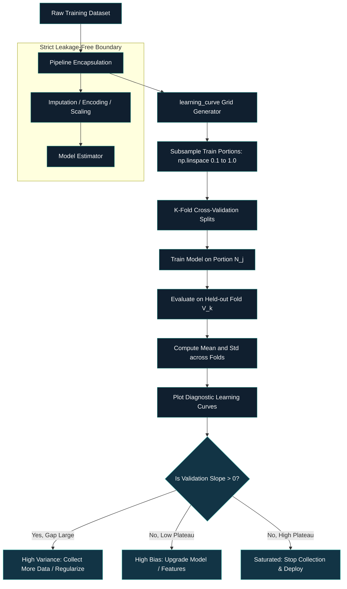

# 🎯 [Data Science & AI/ML]() ⥂ [Model Evaluation, Benchmarking & Selection]() ➝ [Class 11]() ➝ [Learning Curves]()

[**Institution:**]() Pontifical Catholic University of São Paulo (PUC-SP) <br>
[**School:**]() FACEI — Computer Science Department <br>
[**Course:**]() BSc in Human-Centered AI & Data Science • 6th Semester • 2026 <br>
[**Subject:**]() Data Science & Machine Learning — Model Evaluation, Benchmarking & Selection <br>
[**Extensionist Projects:**]() Social projects with open-source software for community support <br>
**Professor:** [✨ Giovani Giulio Tristão Thibes Vieira]() <br>
**Author:** [Fabiana ⚡️ Campanari]()

<br><br>

<p align="center">


</p>

> **Class Context:** This master documentation synthesizes Class 11 (*Curvas de Aprendizado: Vale a pena coletar mais dados?*) from the Human-Centered AI & Data Science curriculum. It formalizes empirical sample complexity diagnostics, bias-variance identification, and data acquisition ROI analysis.

---

## [Table of Contents]()

1. [Repository Identity](#repository-identity)
2. [Source Audit and Class Context](#source-audit-and-class-context)
3. [Overview and Core Problem](#overview-and-core-problem)
4. [Learning Curves vs. Validation Curves](#learning-curves-vs-validation-curves)
5. [Mathematical and Theoretical Foundations](#mathematical-and-theoretical-foundations)
6. [Diagnostic Signatures and Decision Framework](#diagnostic-signatures-and-decision-framework)
7. [Decision Matrix](#decision-matrix)
8. [Empirical Sample Scaling Economics](#empirical-sample-scaling-economics)
9. [Architecture and ML Pipeline](#architecture-and-ml-pipeline)
10. [Executable Code Implementation](#executable-code-implementation)
11. [Common Pitfalls and Best Practices](#common-pitfalls-and-best-practices)
12. [Technology Stack](#technology-stack)
13. [Installation and Usage](#installation-and-usage)
14. [References](#references)
15. [Conclusion](#conclusion)

## [Repository Identity]()

| Field | Value |
|---|---|
| Repository name | `class-11-ai-ml-learning-curves` |
| GitHub About | Diagnostic learning curves for sample complexity analysis, bias-variance tradeoff, and data collection decision-making. |
| Topics | `machine-learning`, `data-science`, `model-evaluation`, `learning-curve`, `bias-variance-tradeoff`, `cross-validation`, `scikit-learn` |
| Lesson | Class 11 — Learning Curves: Is It Worth Collecting More Data? |
| Ecosystem | Human Understanding (HU) / AI & Machine Learning Course Series |

## [Source Audit and Class Context]()

| Resource | Inspection Status | Scope / Role |
|---|---|---|
| `class_11-Learning-Curves-is-it-worth-collecting-more-data.mp4` | Analyzed primary audio/video transcription and presentation slides. | Authoritative basis for curriculum, taxonomy, decision rules, and examples. |
| Slide Deck: *Ciência de Dados 1 · Curvas de Aprendizado (Aula 11)* | Verified via video frames. | Core structure: definition, bias/variance signatures, sample scaling table, scikit-learn API, common pitfalls. |
| Prior Lessons (Class 06–10) | Cross-referenced for continuity. | Class 10 focused on Validation Curves (hyperparameter sensitivity); Class 11 focuses on Learning Curves (sample size sensitivity). |

### Status Conventions
- **Implemented / Demonstrated:** Explicitly taught and demonstrated in the Class 11 lecture video and slide deck.
- **Conceptual:** Theoretical diagnostic frameworks and business decision economics.
- **Recommended:** Engineering and MLOps best practices for production experimentation.

## [Overview and Core Problem]()

A fundamental challenge in applied Machine Learning is deciding **when to stop collecting data** and **when to modify model architecture**. Data acquisition, labeling, and compute costs scale non-linearly. Without systematic empirical diagnostics, teams often make expensive mistakes:

1. **Premature data acquisition:** Spending significant budget to label more records when the underlying model suffers from high bias (underfitting).
2. **Under-resourced capacity:** Terminating data collection prematurely when high variance indicates that additional samples would steadily close the generalization gap.

Learning Curves address this dilemma by plotting an estimator's training and cross-validated test scores as a function of **training dataset size** ($N$), transforming subjective intuition into data-driven decision-making.

## [Learning Curves vs. Validation Curves]()

It is crucial to distinguish between the complementary diagnostic tools introduced in Classes 10 and 11:

| Dimension | Validation Curve (Class 10) | Learning Curve (Class 11) |
|---|---|---|
| **Horizontal Axis ($X$)** | Single hyperparameter value (e.g., `max_depth`, `C`, `gamma`) | Number of training examples ($N$ or percentage of training data) |
| **Fixed Factor** | Training dataset size held constant | Hyperparameter configuration held constant |
| **Diagnostic Question** | What is the optimal model capacity / regularizer? | Does the model benefit from more training observations? |
| **Core Decision** | Parameter tuning and model architecture selection | Data acquisition, labeling budget, and compute allocation |
| **scikit-learn API** | `sklearn.model_selection.validation_curve` | `sklearn.model_selection.learning_curve` |

## [Mathematical and Theoretical Foundations]()

Let $\mathcal{D} = \{(x_i, y_i)\}_{i=1}^M$ be the available training partition. We evaluate subsets $\mathcal{D}_{N_j} \subset \mathcal{D}$ of increasing sample sizes:
\[
N_1 < N_2 < \dots < N_S \le M
\]

For each sample size $N_j$ and across $K$ cross-validation folds ($k = 1, \dots, K$), an estimator $f_{N_j, k}$ is trained on $N_j$ samples from fold training set $T_k$, yielding:

1. **Fold Training Score:**
\[
s_{\mathrm{train}, k}(N_j) = \mathcal{M}\left(f_{N_j, k}, T_{k, N_j}\right)
\]
2. **Fold Validation Score (Held-Out Fold):**
\[
s_{\mathrm{val}, k}(N_j) = \mathcal{M}\left(f_{N_j, k}, V_k\right)
\]

where $\mathcal{M}(\cdot)$ is the designated evaluation metric (e.g., ROC-AUC, Log-Loss, $F_1$, Accuracy).

The mean training and validation trajectories are:
\[
\bar{s}_{\mathrm{train}}(N_j) = \frac{1}{K}\sum_{k=1}^K s_{\mathrm{train}, k}(N_j), \qquad \bar{s}_{\mathrm{val}}(N_j) = \frac{1}{K}\sum_{k=1}^K s_{\mathrm{val}, k}(N_j)
\]

### The Generalization Gap
The empirical generalization gap at sample size $N_j$ is defined as:
\[
\Delta(N_j) = \bar{s}_{\mathrm{train}}(N_j) - \bar{s}_{\mathrm{val}}(N_j)
\]

### Asymptotic Trajectories
- As $N_j \to \infty$, for consistent estimators, $\Delta(N_j) \to 0$.
- In practice, small $N$ yields near-perfect training score ($\bar{s}_{\mathrm{train}} \approx 1.0$) because the model easily memorizes few points, while held-out performance $\bar{s}_{\mathrm{val}}$ is poor.
- As $N$ increases, $\bar{s}_{\mathrm{train}}$ decreases slightly and $\bar{s}_{\mathrm{val}}$ increases asymptotically toward the Bayes optimal rate minus inherent model bias.

## [Diagnostic Signatures and Decision Framework]()

### 1. High Bias (Underfitting)
- **Visual Pattern:** Both training and validation curves converge rapidly to a **low performance plateau**. The gap $\Delta(N)$ is small, but both scores are unacceptable relative to the baseline.
- **Root Cause:** The hypothesis class lacks capacity (inflexible model, insufficient features, excessive regularization).
- **Decision:** **DO NOT collect more data.** Additional samples will not improve performance because the model cannot represent the data distribution.
- **Action Plan:** Switch to a richer model architecture, engineer domain features, decrease regularization, or add polynomial interactions.

---

### 2. High Variance (Overfitting)
- **Visual Pattern:** Training score remains high, validation score is notably lower, resulting in a **large generalization gap $\Delta(N)$**. Crucially, the validation curve maintains a **positive slope** ($rac{dar{s}_{\mathrm{val}}}{dN} > 0$) at the maximum available $N$.
- **Root Cause:** The model has sufficient capacity but lacks enough training examples to constrain variance across unseen regions.
- **Decision:** **COLLECT MORE DATA.** The trajectory indicates further samples will directly boost validation score and narrow the gap.
- **Alternative / Supplementary Action:** Apply regularization, prune decision trees, use dropout, or perform feature selection if data collection is cost-prohibitive.

---

### 3. Saturated Model (Optimal Convergence)
- **Visual Pattern:** Both curves have flattened into a parallel plateau at an acceptable performance level ($rac{dar{s}_{\mathrm{val}}}{dN} pprox 0$).
- **Decision:** **STOP data collection.** Marginal gains from additional samples are negligible (e.g., doubling data from 2,000 to 4,000 samples yielding $< 0.005$ score increase).

## [Decision Matrix]()

| Observed Curve Pattern | Statistical Diagnosis | Root Cause | Prescribed Engineering Action |
|---|---|---|---|
| **Low training, low validation, small gap, early plateau** | **High Bias** *(Underfitting)* | Model capacity / features are the bottleneck | **Do NOT collect data.** Increase model capacity, engineer features, reduce regularization. |
| **High training, lower validation, large gap, positive validation slope** | **High Variance** *(Overfitting)* | Sample size is insufficient to constrain model parameters | **Collect more data** (or regularize / simplify model). |
| **High training, high validation, small gap, plateau reached** | **Optimal Fit** | Reached empirical performance ceiling for current configuration | **Maintain current dataset size.** Optimize inference latency / deployment pipelines. |

## [Empirical Sample Scaling Economics]()

Consider the concrete quantitative example demonstrated in the lecture, illustrating diminishing returns when doubling training volume:

| Training Samples ($N$) | Validation Score | Marginal Gain ($\Delta s$) | Cost / Compute Multiplier |
|---|---|---|---|
| **100** | $0.700$ | — | $1	imes$ baseline |
| **500** | $0.800$ | $+0.100$ | $5	imes$ |
| **1,000** | $0.840$ | $+0.040$ | $2	imes$ previous ($10	imes$ baseline) |
| **2,000** | $0.850$ | $+0.010$ | $2	imes$ previous ($20	imes$ baseline) |
| **4,000** | $0.855$ | $+0.005$ | $2	imes$ previous ($40	imes$ baseline) |

### Key Economic Takeaways
- Doubling data from $100 	o 500$ gives a substantial $+10\%$ improvement.
- Doubling data from $2,000 	o 4,000$ yields only $+0.5\%$ improvement while doubling cloud compute, storage, memory, and annotation costs.
- **Stopping at $N=1,000$ or $N=2,000$** is often the optimal business decision, avoiding $2	imes$ to $4	imes$ cloud compute expenditure for negligible real-world returns.

## [Architecture and ML Pipeline]()



## [Executable Code Implementation]()

The standard, leak-free scikit-learn implementation demonstrated in Class 11:

```python
import numpy as np
import matplotlib.pyplot as plt
from sklearn.model_selection import learning_curve
from sklearn.pipeline import Pipeline
from sklearn.preprocessing import StandardScaler
from sklearn.linear_model import LogisticRegression

# 1. Define complete pipeline to prevent data leakage during subsampling & CV
pipeline = Pipeline([
    ("scaler", StandardScaler()),
    ("classifier", LogisticRegression(max_iter=1000, random_state=42))
])

# 2. Define sample size fractions (e.g., 8 intervals from 10% to 100%)
train_sizes_fraction = np.linspace(0.1, 1.0, 8)

# 3. Compute learning curve across 5-fold cross-validation
train_sizes_abs, train_scores, val_scores = learning_curve(
    estimator=pipeline,
    X=X_train,
    y=y_train,
    train_sizes=train_sizes_fraction,
    cv=5,
    scoring="roc_auc",
    n_jobs=-1,
    random_state=42
)

# 4. Aggregate metrics across folds
train_mean = np.mean(train_scores, axis=1)
train_std = np.std(train_scores, axis=1)
val_mean = np.mean(val_scores, axis=1)
val_std = np.std(val_scores, axis=1)

# 5. Diagnostic inspection
for n, tr, va in zip(train_sizes_abs, train_mean, val_mean):
    print(f"N={n:5d} | Train ROC-AUC: {tr:.4f} | Val ROC-AUC: {va:.4f} | Gap: {tr - va:.4f}")
```

### Explanatory Details
- **`train_sizes`:** Pass relative fractions (`np.linspace(0.1, 1.0, 8)`) or absolute sample counts. Passing at least 6–10 points ensures a smooth, readable curve rather than coarse geometric lines.
- **`cv=5`:** Cross-validation guarantees that validation scores reflect out-of-fold generalization, not training memory.
- **`Pipeline` encapsulation:** Ensures standard scaling and transformers fit *only* on the active subsampled training slice, eliminating optimistic leakage.

## [Common Pitfalls and Best Practices]()

### Common Pitfalls to Avoid
1. **Reading the training curve instead of the validation curve:** Training score only measures how well the model memorizes seen data; only the validation curve estimates true generalization performance.
2. **Concluding 'collect more data' when bias is high:** Collecting millions of extra samples for an underfitting model yields zero gains and major compute waste.
3. **Using too few sample evaluation points (broken curves):** Passing only 2 or 3 training sizes produces jagged lines that obscure subtle saturation knees.
4. **Constructing the curve outside of a Pipeline:** Applying transformations (e.g., global scaling, imputation) before subsampling leaks distribution parameters into the validation folds.
5. **Ignoring temporal regime changes:** Training on massive historical datasets (e.g., 10 years of pre-pandemic data) may degrade generalization if target distributions have shifted (*concept drift*).

### Best Practices Checklist
- [x] Inspect the **final validation slope** ($rac{dar{s}_{\mathrm{val}}}{dN}$) at the maximum data point.
- [x] Diagnose bias vs. variance **before** committing resources to data acquisition.
- [x] Use at least 6–8 evaluation sample points along the $X$-axis.
- [x] Wrap estimators and transformers in a `Pipeline` for every evaluation fold.
- [x] Translate statistical curves into tangible **business decisions** (cost of labeling vs. marginal KPI gain).

## [Technology Stack]()

| Category | Technology / Library | Role in Class 11 |
|---|---|---|
| **Language** | Python 3.10+ | Core implementation environment |
| **ML Framework** | scikit-learn (`learning_curve`, `Pipeline`) | Cross-validated sample complexity computation |
| **Data Processing** | NumPy, Pandas | Array slicing, linear spacing, table generation |
| **Visualization** | Matplotlib / Seaborn | Diagnostic dual-curve visualization |
| **Architecture** | Git / GitHub | Reproducible technical documentation and version control |

## [Installation and Usage]()

### Environment Setup
```bash
# Clone repository
git clone https://github.com/Mindful-AI-Research/class-11-ai-ml-learning-curves.git
cd class-11-ai-ml-learning-curves

# Create and activate virtual environment
python -m venv .venv
source .venv/bin/activate  # On Windows: .venv\Scripts\activate

# Install dependencies
pip install scikit-learn numpy pandas matplotlib
```

### Execution
Run the standalone diagnostic script or Jupyter notebook:
```bash
python scripts/run_learning_curve.py
```

## [References]()

1. Thibes Vieira, G. G. T. *Ciência de Dados 1 · Curvas de Aprendizado: Vale a pena coletar mais dados? (Aula 11)*. Pontifical Catholic University of São Paulo (PUC-SP), 2026.
2. Scikit-Learn Documentation. *Validation curves and learning curves: Plotting scores to evaluate models*. [https://scikit-learn.org/stable/modules/learning_curve.html](https://scikit-learn.org/stable/modules/learning_curve.html).
3. Scikit-Learn API Reference. `sklearn.model_selection.learning_curve`. [https://scikit-learn.org/stable/modules/generated/sklearn.model_selection.learning_curve.html](https://scikit-learn.org/stable/modules/generated/sklearn.model_selection.learning_curve.html).
4. Hastie, T., Tibshirani, R., & Friedman, J. *The Elements of Statistical Learning: Data Mining, Inference, and Prediction*. Springer, 2nd ed., 2009.

## [Conclusion]()

Class 11 elevates model evaluation from passive performance reporting to **active engineering economics**. By examining the rate of change of validation scores across sample sizes, machine learning engineers can conclusively determine whether a project's bottleneck is **data scarcity** or **model inadequacy**, ensuring that capital and engineering hours are deployed where they yield maximal return.

<br><br>

<!-- ========= Start GITHUB BADGE ========= -->
<p align="center">
<a href="https://github.com/Mindful-AI-Research">

</a>
</p>
<!-- ========= END GITHUB BADGE ========= -->
