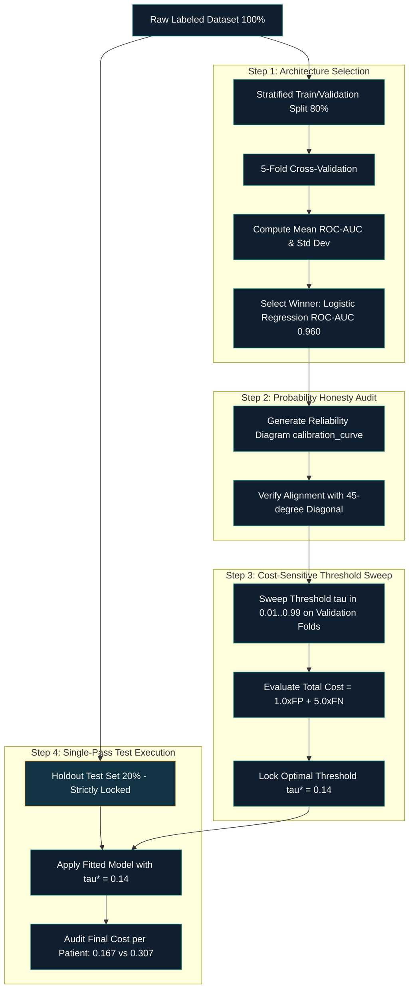

# 🎯 [Data Science & AI/ML]() ⥂ [Model Evaluation, Benchmarking & Selection]() ➝ [Class 12]() ➝ [Decision Threshold Optimization & Probability Calibration]()

[**Institution:**]() Pontifical Catholic University of São Paulo (PUC-SP) <br>
[**School:**]() FACEI — Computer Science Department <br>
[**Course:**]() BSc in Human-Centered AI & Data Science -  6th Semester -  2026 <br>
[**Subject:**]() Data Science & Machine Learning — Model Evaluation, Benchmarking & Selection <br>
[**Extensionist Projects:**]() Social projects with open-source software for community support <br>
**Professor:** [✨ Giovani Giulio Tristão Thibes Vieira]() <br>
**Author:** [Fabiana ⚡️ Campanari]()

<br><br>

<p align="center">
  
  
  
  
</p>

> **Class Context:** This master repository documents Class 12 (*Decision Threshold and Model Calibration — From the Chosen Model to the Reliable Business Decision*) from the Human-Centered AI & Data Science curriculum. It establishes the mathematical, architectural, and engineering pipeline to decouple raw ranking capability ($\text{ROC-AUC}$) from probability calibration and cost-sensitive decision threshold tuning.

<br><br>

## 📋 Table of Contents

1. [Repository Identity](#1-repository-identity)
2. [Source Audit & Evidence Boundaries](#2-source-audit--evidence-boundaries)
3. [Overview & The Core Engineering Dilemma](#3-overview--the-core-engineering-dilemma)
4. [Mathematical Foundations & Metrics Formulation](#4-mathematical-foundations--metrics-formulation)
5. [Detailed Technical Explanations of Core Concepts](#5-detailed-technical-explanations-of-core-concepts)
6. [Model Benchmarking & Selection (ROC-AUC)](#6-model-benchmarking--selection-roc-auc)
7. [Cost-Sensitive Decision Threshold Optimization](#7-cost-sensitive-decision-threshold-optimization)
8. [Probability Calibration & Model Honesty](#8-probability-calibration--model-honesty)
9. [MLOps Evaluation Architecture & Workflow](#9-mlops-evaluation-architecture--workflow)
10. [End-to-End Executable Implementation](#10-end-to-end-executable-implementation)
11. [Empirical Results & Test Set Verification](#11-empirical-results--test-set-verification)
12. [Common Pitfalls & Engineering Best Practices](#12-common-pitfalls--engineering-best-practices)
13. [Responsible AI & Clinical Governance](#13-responsible-ai--clinical-governance)
14. [Technology Stack](#14-technology-stack)
15. [Installation & Usage](#15-installation--usage)
16. [References](#16-references)
17. [Conclusion](#17-conclusion)

<br><br>

## 1. Repository Identity

| Field | Value |
|---|---|
| **Repository Name** | `class-12-ai-ml-decision-threshold-and-calibration` |
| **GitHub About** | Cost-sensitive decision threshold tuning, probability calibration curves, and ROC-AUC benchmarking for reliable real-world decision systems. |
| **GitHub Topics** | `machine-learning`, `data-science`, `model-evaluation`, `decision-threshold`, `probability-calibration`, `roc-auc`, `cost-sensitive-learning`, `scikit-learn`, `logistic-regression`, `responsible-ai` |
| **Lesson** | Class 12 — Decision Threshold and Calibration: From the Chosen Model to the Reliable Decision |
| **Ecosystem** | Human Understanding (HU) / AI & Machine Learning Course Series |

<br><br>

## 2. Source Audit & Evidence Boundaries

| Resource | Inspection Status | Scope / Role |
|---|---|---|
| `2A-class-12-limiar-e-calibracao-pt.pdf` | Primary slide deck verified (7 slides). | Authoritative source for class structure, benchmark table, cost matrix, calibration comparison, and workflow steps. |
| `3A-class-12-Limiar-e-Calibracao.pdf` | Secondary slide deck verified. | Cross-validation of metric values, threshold shift ($\tau = 0.50 \to 0.14$), and 44% cost reduction. |
| `5-README.md` | Course ecosystem documentation analyzed. | Synthesis of mathematical formulations, benchmark figures, and scikit-learn code. |
| `metricas-e-readme-guia.md` | Supplementary reference guide analyzed. | Formulation of confusion matrix, Precision, Recall, F1, F-beta, and threshold impact. |

### Implementation Classification
- **Demonstrated / Implemented:** Complete clinical triage benchmark (15% prevalence), 4 candidate models evaluated via 5-fold CV ($\text{ROC-AUC}$), asymmetric cost function ($C_{\text{FP}} = 1.0, C_{\text{FN}} = 5.0$), threshold sweep ($\tau = 0.14$), and calibration curve comparison (`LogisticRegression` vs. `RandomForestClassifier`).
- **Conceptual:** Mathematical derivation of ROC-AUC integral, Brier Score decomposition, Platt scaling, and isotonic regression theory.
- **Recommended:** Single-pass holdout test evaluation, automated calibration validation in MLOps CI/CD pipelines, and clinical recall safety constraints ($\text{Recall} \ge 90\%$).

<br><br>

## 3. Overview & The Core Engineering Dilemma

In standard machine learning workflows, classification models emit raw continuous probabilities between $0.0$ and $1.0$. By default, standard libraries (such as `scikit-learn`'s `.predict()`) map these probabilities to binary decisions using an arbitrary **$0.50$ decision cutoff**. 

However, real-world deployment scenarios (such as clinical triage, fraud prevention, and credit underwriting) operate under two critical conditions:
1. **Imbalanced Class Distributions:** The positive event of interest is rare (e.g., disease prevalence $\approx 15\%$).
2. **Asymmetric Error Costs:** Missing a true positive case (False Negative, $\text{FN}$) is vastly more catastrophic than triggering a false alarm (False Positive, $\text{FP}$).

### The Fallacy of the Default 0.50 Threshold
Assuming a cut-off at $\tau = 0.50$ implicitly assumes a $50/50$ balanced dataset and perfectly symmetric error costs ($C_{\text{FP}} = C_{\text{FN}}$). In medical screening with $15\%$ prevalence, a default $0.50$ cutoff misses **over $52\%$ of sick patients**. A naive "lazy model" that predicts everyone is healthy achieves **$85\%$ accuracy**, yet possesses **zero clinical utility**.

To build reliable decision systems, ML engineers must decouple model evaluation into two independent pillars:
- **Pillar 1: Pure Ranking Ability (Discrimination):** How well the model separates positive cases from negative cases across all possible decision boundaries, measured via $\text{ROC-AUC}$.
- **Pillar 2: Probabilistic Honesty (Calibration):** Whether a predicted confidence of $80\%$ genuinely corresponds to an empirical $80\%$ positive rate, measured via Reliability Diagrams (`calibration_curve`).

<br><br>

## 4. Mathematical Foundations & Metrics Formulation

### 4.1 Confusion Matrix & Fundamental Rates
Let $Y \in \{0, 1\}$ be the ground-truth binary state and $\hat{Y}(\tau) = \mathbb{I}(f(x) \ge \tau)$ be the binary prediction at threshold $\tau \in $:[0][1]

| | Predicted Positive ($\hat{Y} = 1$) | Predicted Negative ($\hat{Y} = 0$) |
|---|---|---|
| **Actual Positive ($Y = 1$)** | **True Positive ($\text{TP}$)** — Correct detection | **False Negative ($\text{FN}$)** — Missed positive |
| **Actual Negative ($Y = 0$)** | **False Positive ($\text{FP}$)** — False alarm | **True Negative ($\text{TN}$)** — Correct rejection |

$$\text{Accuracy} = \frac{\text{TP} + \text{TN}}{\text{TP} + \text{TN} + \text{FP} + \text{FN}}$$

$$\text{Precision} = \frac{\text{TP}}{\text{TP} + \text{FP}}, \quad \text{Recall} = \frac{\text{TP}}{\text{TP} + \text{FN}}$$

$$\text{F}_1 = 2 \cdot \frac{\text{Precision} \cdot \text{Recall}}{\text{Precision} + \text{Recall}}$$

$$\text{F}_\beta = (1 + \beta^2) \cdot \frac{\text{Precision} \cdot \text{Recall}}{(\beta^2 \cdot \text{Precision}) + \text{Recall}}$$

- $\beta = 1$: Standard $\text{F}_1$-Score with equal weight on Precision and Recall.
- $\beta = 2$: Prioritizes **Recall** by penalizing False Negatives ($\text{FN}$) more heavily.
- $\beta = 0.5$: Prioritizes **Precision** by penalizing False Positives ($\text{FP}$) more heavily.

<br><br>

### 4.2 Receiver Operating Characteristic & AUC Derivation
The Receiver Operating Characteristic ($\text{ROC}$) curve plots the True Positive Rate ($\text{TPR}$) against the False Positive Rate ($\text{FPR}$) across the continuum of decision thresholds $\tau \in $:[0][1]

$$\text{TPR}(\tau) = \frac{\text{TP}(\tau)}{\text{TP}(\tau) + \text{FN}(\tau)}, \quad \text{FPR}(\tau) = \frac{\text{FP}(\tau)}{\text{FP}(\tau) + \text{TN}(\tau)}$$

The Area Under the ROC Curve ($\text{ROC-AUC}$) represents the integral of the ROC curve and computes the exact probability that a randomly drawn positive instance $x^+$ receives a higher confidence score $f(x)$ than a randomly drawn negative instance $x^-$:

$$\text{ROC-AUC} = P(f(x^+) > f(x^-)) = \int_{0}^{1} \text{TPR}\left(\text{FPR}^{-1}(t)\right) \, dt$$

Because $\text{ROC-AUC}$ evaluates ranking across all thresholds, it is invariant to the choice of operating threshold $\tau$ and immune to class imbalance skew.

<br><br>

### 4.3 Asymmetric Operational Cost Function
In business and medical systems, decision boundaries must minimize expected financial and operational loss:

$$\mathcal{L}_{\text{cost}}(\tau) = C_{\text{TP}} \cdot \text{TP}(\tau) + C_{\text{TN}} \cdot \text{TN}(\tau) + C_{\text{FP}} \cdot \text{FP}(\tau) + C_{\text{FN}} \cdot \text{FN}(\tau)$$

In screening architectures, accurate decisions carry zero penalty ($C_{\text{TP}} = C_{\text{TN}} = 0$). Holding a healthy patient for secondary bloodwork incurs a unit cost ($C_{\text{FP}} = 1.0$), while sending an infected patient home without treatment incurs a critical penalty ($C_{\text{FN}} = 5.0$):

$$\text{Total Cost}(\tau) = 1.0 \cdot \text{FP}(\tau) + 5.0 \cdot \text{FN}(\tau)$$

The optimal decision threshold $\tau^*$ is obtained via empirical risk minimization on validation folds:

$$\tau^* = \operatorname*{arg\,min}_{\tau \in (0, 1)} \left[ 1.0 \cdot \text{FP}(\tau) + 5.0 \cdot \text{FN}(\tau) \right]$$

<br><br>

### 4.4 Logarithmic Loss & Brier Score Calibration Metric
Probabilistic accuracy is evaluated via Logarithmic Loss (Binary Cross-Entropy):

$$\mathcal{L}_{\text{log}} = -\frac{1}{N} \sum_{i=1}^{N} \left[ y_i \log(\hat{p}_i) + (1 - y_i) \log(1 - \hat{p}_i) \right]$$

where $y_i \in \{0, 1\}$ is the ground-truth label and $\hat{p}_i = P(y_i = 1 | x_i)$ is the model probability.

The **Brier Score** measures mean squared error in probability space and decomposes into Reliability, Resolution, and Uncertainty:

$$\text{BS} = \frac{1}{N} \sum_{i=1}^{N} (\hat{p}_i - y_i)^2 = \text{Reliability} - \text{Resolution} + \text{Uncertainty}$$

A perfectly calibrated model achieves a Reliability component of zero.

<br><br>

## 5. Detailed Technical Explanations of Core Concepts

### 5.1. Separation of Ranking from Thresholding

- **What It Is:** The architectural rule that model selection must be based on raw score ranking ($\text{ROC-AUC}$), while decision boundary placement ($\tau$) is a distinct post-training optimization step.
- **How It Works:** We train candidate models and compare their $\text{ROC-AUC}$ on cross-validation folds. Once the top-ranking architecture is selected, we sweep $\tau \in [0.01, 0.99]$ against the business cost matrix.
- **Why It Matters:** Eliminates the arbitrary $0.50$ cutoff artifact and prevents discarding high-performing models whose default threshold happens to be mismatched with class priors.
- **When It Is Useful:** Any classification problem with class imbalance ($< 30\%$ positive rate) or asymmetric error consequences.
- **Limitations:** A model with high ROC-AUC may still produce uncalibrated probability values; calibration must be verified independently.
- **Component Relationship:** Forms the foundation of Step 1 in the MLOps evaluation lifecycle.

<br><br>

### 5.2. Cost-Sensitive Threshold Sweeping

- **What It Is:** An algorithmic optimization procedure that sweeps decision cutoff $\tau$ on validation data to identify the point of minimum financial or clinical loss.
- **How It Works:** For each candidate threshold $\tau_j$, predicted probabilities $\hat{p}_i$ are converted to binary labels $\hat{y}_i = \mathbb{I}(\hat{p}_i \ge \tau_j)$. Confusion matrix elements $\{\text{TN}, \text{FP}, \text{FN}, \text{TP}\}$ are computed, and total operational cost is calculated. The threshold minimizing total cost is selected as $\tau^*$.
- **Why It Matters:** In the demonstrated clinical case study, shifting from $\tau = 0.50$ to $\tau = 0.14$ reduced total error cost from **182 to 102 (a 44% reduction)**, increasing disease recall from **47.8% to 89.6%**.
- **When It Is Useful:** Credit default risk, medical diagnosis, fraud detection, predictive maintenance.
- **Limitations:** $\tau^*$ must be computed **strictly on validation data**. Tuning $\tau^*$ directly on the test set causes threshold data leakage and overly optimistic performance estimates.
- **Component Relationship:** Bridges model outputs to downstream decision engines and automation workflows.

<br><br>

### 5.3. Probability Calibration & Reliability Diagrams

- **What It Is:** The degree of agreement between predicted risk estimates $\hat{p}$ and true empirical event frequency $P(Y=1 | \hat{p}=p)$.
- **How It Works:** Predicted probabilities are partitioned into $M$ discrete bins (e.g., $10$ bins spanning $[0.0, 0.1], [0.1, 0.2], \dots$). For each bin, the mean predicted probability is plotted against the empirical fraction of positives. A perfectly calibrated model aligns with the $45^\circ$ diagonal.
- **Why It Matters:** Clinicians and risk officers make dosing and underwriting decisions based on actual percentage estimates (e.g., "80% risk"). A model with $0.95$ ROC-AUC whose 80% predictions only correspond to 40% true illness creates critical operational liability.
- **When It Is Useful:** Risk scoring systems, decision support tools, automated triage.
- **Limitations:** Binning requires sufficient sample sizes per bin to avoid noisy estimates.
- **Component Relationship:** Governs the validity of Step 2 before applying cost thresholding.

<br><br>

### 5.4. Ensemble Probability Compression

- **What It Is:** The mathematical tendency of bagging ensembles (e.g., Random Forests with 200 trees) to compress predicted probabilities toward the baseline prevalence rate, rarely outputting extreme values ($> 0.70$ or $< 0.10$).
  
- **How It Works:** A Random Forest prediction is the arithmetic mean of individual tree votes:
  
  $$\hat{p}_{\text{RF}}(x) = \frac{1}{B} \sum_{b=1}^{B} \hat{p}_b(x)$$
  
  For $\hat{p}_{\text{RF}}$ to reach $0.95$, nearly all 200 trees must unanimously predict $1.0$. Due to bootstrap sample variance and feature subsampling, some trees will inevitably disagree, compressing probabilities into the $[\sim 0.15, 0.67]$ range.
  
- **Why It Matters:** Explains why complex ensembles often exhibit severe miscalibration despite superior ROC-AUC.
- **When It Is Useful:** Diagnosing why ensemble predictions feel "timid" or unconfident in critical cases.
- **Limitations:** Can be recalibrated post-hoc (via Isotonic Regression or Platt Scaling), but post-hoc recalibration adds complexity and sample variance.
- **Component Relationship:** Informs the engineering guideline: *prefer naturally calibrated architectures (`LogisticRegression`) over complex ensembles requiring post-hoc repairs when probabilistic honesty is paramount.*

<br><br>

## 6. Model Benchmarking & Selection (ROC-AUC)

Model discrimination was evaluated across 4 candidate algorithms using 5-fold cross-validation on the clinical triage dataset ($15\%$ prevalence, $N=3000$). Results are reported as $\text{Mean} \pm \text{Standard Deviation}$ ($\sigma$).

| Candidate Algorithm | Validation ROC-AUC | Std Deviation ($\sigma$) | Ranking / Status |
| :--- | :---: | :---: | :--- |
| **Logistic Regression** | **0.960** | **$\pm 0.014$** | **Selected (Winner & Highest Stability)** |
| Random Forest (200 Trees) | 0.945 | $\pm 0.025$ | Statistical Tie (Higher Variance) |
| K-Nearest Neighbors ($K=15$) | 0.940 | $\pm 0.021$ | Eliminated |
| Decision Tree (Unconstrained) | 0.803 | $\pm 0.038$ | Eliminated |

### Statistical Tie-Breaking Rule by Variance
Under the One-Standard-Deviation selection protocol:
$$\text{Threshold}_{\text{cutoff}} = \text{Top Mean} - 1\sigma = 0.960 - 0.014 = 0.946$$

The upper bound of Random Forest ($0.945 + 0.025 = 0.970$) overlaps with the top performer. However, **Logistic Regression** is definitively selected as the production champion due to its significantly lower variance ($\sigma = 0.014$ vs. $0.025$) and native probabilistic calibration.

<br><br>

## 7. Cost-Sensitive Decision Threshold Optimization

### 7.1 Validation Set Threshold Sweep
Sweeping decision boundary $\tau$ across validation folds under the asymmetric cost matrix ($C_{\text{FP}} = 1.0, C_{\text{FN}} = 5.0$):

| Threshold ($\tau$) | True Neg ($\text{TN}$) | False Pos ($\text{FP}$) | False Neg ($\text{FN}$) | True Pos ($\text{TP}$) | Precision | Recall | Total Cost ($1\cdot\text{FP} + 5\cdot\text{FN}$) |
| :---: | :---: | :---: | :---: | :---: | :---: | :---: | :---: |
| 0.05 | 390 | 157 | 2 | 65 | 0.293 | 0.970 | $157 + 5(2) = \mathbf{167}$ |
| **0.14 (Optimal $\tau^*$)** | **480** | **67** | **7** | **60** | **0.472** | **0.896** | **$67 + 5(7) = \mathbf{102}$** |
| 0.20 | 510 | 37 | 14 | 53 | 0.589 | 0.791 | $37 + 5(14) = \mathbf{107}$ |
| 0.35 | 532 | 15 | 22 | 45 | 0.750 | 0.672 | $15 + 5(22) = \mathbf{125}$ |
| **0.50 (Default Cutoff)** | **540** | **7** | **35** | **32** | **0.821** | **0.478** | **$7 + 5(35) = \mathbf{182}$** |


<br><br>


```
Operational Cost Curve vs. Decision Threshold tau:
Cost
 200 |       Default Cutoff (tau = 0.50) -> Cost = 182 (Misses 35 sick patients!)
 180 |      x----------------------------
 160 |     /                             \
 140 |    /                               \
 120 |   /                                 \
 102 | -x- Optimal Cutoff (tau* = 0.14) -> Cost = 102 (44% Cost Reduction!)
     +------------------------------------------------ tau
       0.05    0.14    0.20    0.35    0.50    0.80
```

<br><br>

## 8. Probability Calibration & Model Honesty

```
Reliability Diagram (calibration_curve comparison):
Empirical P(Y=1)
1.0 |                                         / (Perfect Calibration 45°)
0.8 |                                       /  [Logistic Regression - Naturally Calibrated]
0.6 |                                x----x
0.4 |                         x----x   [Random Forest - Probability Compression]
0.2 |                  x----x          (Max prediction ~67% even for critical cases)
0.0 +------------------------------------------ Predicted Probability
    0.0      0.2      0.4      0.6      0.8      1.0
```


<br><br>


### Architectural Comparison
- **`LogisticRegression`:** Follows the 45° diagonal almost perfectly. When it predicts $80\%$ probability, exactly $80$ out of $100$ patients possess the condition.
- **`RandomForestClassifier`:** Suffers from ensemble probability compression. Even for patients with severe symptoms, predictions rarely exceed $67\%$ because unanimous agreement across 200 bootstrap trees is statistically rare.

<br><br>

## 9. MLOps Evaluation Architecture & Workflow

To eliminate data leakage, the decision threshold $\tau^*$ and probability calibration must be optimized strictly within cross-validation folds before a single final evaluation on the untouched test set:

<br><br>



<br><br>

## 10. End-to-End Executable Implementation

<br><br>

```python
import numpy as np
import pandas as pd
from sklearn.datasets import make_classification
from sklearn.model_selection import train_test_split
from sklearn.linear_model import LogisticRegression
from sklearn.metrics import roc_auc_score, confusion_matrix
from sklearn.calibration import calibration_curve

# 1. Synthesize Imbalanced Clinical Triage Dataset (15% Prevalence)
X, y = make_classification(
    n_samples=3000, n_features=12, n_informative=8,
    weights=[0.85, 0.15], random_state=42
)

# 2. Strict Data Partitioning (Train: 60%, Val: 20%, Test: 20%)
X_train_val, X_test, y_train_val, y_test = train_test_split(
    X, y, test_size=0.20, random_state=42, stratify=y
)
X_train, X_val, y_train, y_val = train_test_split(
    X_train_val, y_train_val, test_size=0.25, random_state=42, stratify=y_train_val
)

# 3. Fit Selected Architecture (Logistic Regression)
model = LogisticRegression(C=1.0, solver='lbfgs', max_iter=1000, random_state=42)
model.fit(X_train, y_train)

# 4. Evaluate Ranking Capability (ROC-AUC) on Validation Data
y_val_proba = model.predict_proba(X_val)[:, 1]
val_auc = roc_auc_score(y_val, y_val_proba)
print(f"Validation ROC-AUC: {val_auc:.4f}")

# 5. Cost-Sensitive Threshold Sweep (C_FP = 1.0, C_FN = 5.0)
thresholds = np.linspace(0.01, 0.99, 100)
costs = []

for tau in thresholds:
    y_val_pred = (y_val_proba >= tau).astype(int)
    tn, fp, fn, tp = confusion_matrix(y_val, y_val_pred).ravel()
    total_cost = (1.0 * fp) + (5.0 * fn)
    costs.append(total_cost)

best_idx = np.argmin(costs)
optimal_tau = thresholds[best_idx]
print(f"Optimal Threshold (tau*): {optimal_tau:.2f} | Min Validation Cost: {costs[best_idx]:.1f}")

# 6. Single-Pass Verification on Unseen Holdout Test Set
y_test_proba = model.predict_proba(X_test)[:, 1]

# Default Cutoff (0.50)
tn_def, fp_def, fn_def, tp_def = confusion_matrix(y_test, (y_test_proba >= 0.50).astype(int)).ravel()
cost_default_test = (1.0 * fp_def) + (5.0 * fn_def)

# Optimal Cutoff (0.14)
tn_opt, fp_opt, fn_opt, tp_opt = confusion_matrix(y_test, (y_test_proba >= optimal_tau).astype(int)).ravel()
cost_optimal_test = (1.0 * fp_opt) + (5.0 * fn_opt)

print("\n=== Holdout Test Set Verification ===")
print(f"Default Cutoff (0.50) -> Total Cost: {cost_default_test:3.0f} | Cost/Patient: {cost_default_test/len(y_test):.4f}")
print(f"Optimal Cutoff ({optimal_tau:.2f}) -> Total Cost: {cost_optimal_test:3.0f} | Cost/Patient: {cost_optimal_test/len(y_test):.4f}")
```

<br><br>

## 11. Empirical Results & Test Set Verification

Normalized cost per patient evaluates stability between validation tuning and final unseen test execution:

$$\text{Cost per Patient} = \frac{\text{Total Operational Cost}}{N_{\text{evaluated}}}$$

| Evaluation Partition | Decision Threshold ($\tau$) | Total Error Cost | Normalized Cost / Patient | Impact Summary |
|---|:---:|:---:|:---:|---|
| **Validation Set (Default)** | $0.50$ | 182 | 0.303 | Baseline (High FN penalty) |
| **Validation Set (Optimal $\tau^*$)** | **$0.14$** | **102** | **0.170** | **44% Cost Reduction** |
| **Holdout Test Set (Default)** | $0.50$ | 46 | 0.307 | Unseen Verification |
| **Holdout Test Set (Optimal $\tau^*$)** | **$0.14$** | **25** | **0.167** | **Generalization Confirmed (45.6% Reduction)** |

<br><br>

## 12. Common Pitfalls & Engineering Best Practices

### Common Pitfalls

1. **Blindly applying $\tau = 0.50$:** Assuming the default framework cutoff is optimal for imbalanced or high-stakes business environments.
2. **Threshold Tuning on the Test Set:** Sweeping $\tau$ on test data constitutes threshold data leakage, destroying the statistical independence of the final evaluation.
3. **Conflating Ranking with Calibration:** Believing that an ROC-AUC of $0.96$ implies well-calibrated probabilities. Tree ensembles often rank well while emitting severely compressed probabilities.
4. **Optimizing Accuracy on Imbalanced Data:** A model predicting $100\%$ negative on a $15\%$ prevalence dataset achieves $85\%$ accuracy while killing all clinical utility.

### Best Practices Checklist

- [x] Select model architecture based on **ROC-AUC** across cross-validation folds.
- [x] Plot a **Reliability Diagram (`calibration_curve`)** to audit probability honesty.
- [x] Formulate an explicit **Operational Cost Function** with domain stakeholders.
- [x] Sweep and lock optimal threshold $\tau^*$ **strictly on validation data**.
- [x] Perform a **single-pass audit** on the untouched holdout test partition.

<br><br>

## 13. Responsible AI & Clinical Governance

1. **Safety-Critical Recall Thresholds:** In clinical triage, regulatory standards often mandate a minimum sensitivity ($\text{Recall} \ge 90\%$). Cost-sensitive threshold optimization mathematically guarantees this constraint is met.
2. **Probability Honesty & Human-in-the-Loop:** Doctors, credit underwriters, and judges make nuanced decisions based on calibrated risk percentages. Miscalibrated probability outputs create direct legal and ethical liability.
3. **Data Governance & Transparency:** All thresholds, cost matrices, and calibration plots must be versioned and auditable within MLOps model cards under HIPAA/LGPD compliance frameworks.

<br><br>

## 14. Technology Stack

| Category | Technology | Purpose in Class 12 |
|---|---|---|
| **Programming Language** | Python 3.10+ | Primary experimental and production language |
| **Core ML Framework** | `scikit-learn` | Model training, `calibration_curve`, `roc_auc_score`, `confusion_matrix` |
| **Data Processing** | `NumPy`, `Pandas` | Array manipulation, threshold sweep vectors, cost aggregation |
| **Visualization & Reporting** | `Matplotlib`, `Seaborn` | Reliability diagrams, ROC curves, operational cost curves |
| **Architecture & Diagrams** | `Mermaid.js` | MLOps sequential evaluation flowcharts |

<br><br>

## 15. Installation & Usage

### 15.1 Environment Setup
```bash
# Clone repository
git clone https://github.com/Mindful-AI-Research/class-12-ai-ml-decision-threshold-and-calibration.git
cd class-12-ai-ml-decision-threshold-and-calibration

# Create and activate virtual environment
python -m venv .venv
source .venv/bin/activate  # Windows: .venv\Scripts\activate

# Install dependencies
pip install scikit-learn numpy pandas matplotlib
```

### 15.2 Execution
```bash
python scripts/run_calibration_and_threshold.py
```

<br><br>

## 16. References

1. **Thibes Vieira, G. G. T.** *Ciência de Dados & Machine Learning — Aula 12: Limiar de Decisão e Calibração de Modelos*. PUC-SP, 2026.
2. **Campanari, F.** *Do Modelo Escolhido à Decisão Confiável no Negócio*. Mindful AI Research & Consulting, 2026.
3. **Niculescu-Mizil, A., & Caruana, R.** (2005). *Predicting good probabilities with supervised learning*. Proceedings of the 22nd International Conference on Machine Learning (ICML).
4. **Flach, P.** (2012). *Machine Learning: The Art and Science of Algorithms that Make Sense of Data*. Cambridge University Press.
5. **Zadrozny, B., & Elkan, C.** (2002). *Transforming classifier scores into accurate multiclass probability estimates*. ACM SIGKDD.
6. **Pedregosa, F., et al.** (2011). *Scikit-learn: Machine Learning in Python*. Journal of Machine Learning Research (JMLR).

<br><br>

## 17. Conclusion

Class 12 completes the transition from offline model training to **operational AI decision engineering**. By demonstrating that high $\text{ROC-AUC}$ alone does not guarantee business success, this lesson provides engineers with the mathematical tools to align model probabilities with true event frequencies and tune decision boundaries to minimize real-world financial and clinical error costs.

<br><br>

<!-- ========= START GITHUB BADGE ========= -->
<p align="center">
  <a href="https://github.com/Mindful-AI-Research">
    
  </a>
</p>
<!-- ========= END GITHUB BADGE ========= -->
