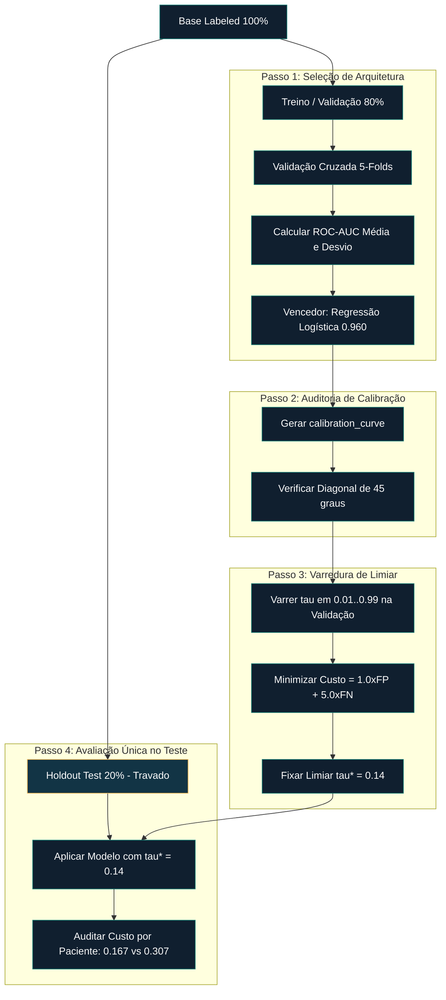

# 🎯 [Data Science & AI/ML]() ⥂ [Model Evaluation, Benchmarking & Selection]() ➝ [Class 12]() ➝ [Otimização do Limiar de Decisão e Calibração de Probabilidades]()

[**Instituição:**]() Pontifícia Universidade Católica de São Paulo (PUC-SP) <br>
[**Faculdade:**]() FACEI — Departamento de Ciência da Computação <br>
[**Curso:**]() Bacharelado em IA Centrada no Humano & Ciência de Dados • 6º Semestre • 2026 <br>
[**Disciplina:**]() Ciência de Dados & Machine Learning — Avaliação, Benchmarking e Seleção de Modelos <br>
[**Projetos Extensionistas:**]() Iniciativas de software livre para apoio comunitário <br>
**Professor:** [✨ Giovani Giulio Tristão Thibes Vieira]() <br>
**Autora:** [Fabiana ⚡️ Campanari]()

<br><br>

<p align="center">


</p>

> **Contexto da Aula:** Este repositório mestre documenta a Aula 12 (*Limiar de Decisão e Calibração de Modelos — Do Modelo Escolhido à Decisão Confiável no Negócio*) do currículo de Ciência de Dados e IA Centrada no Humano da PUC-SP. Estabelece o pipeline matemático, arquitetural e de engenharia para desacoplar a capacidade pura de ordenação ($\text{ROC-AUC}$) da calibração probabilística e do ajuste fino de limiares sensíveis ao custo de negócio.

---

## 📋 Sumário

1. [Identidade do Repositório](#1-identidade-do-repositório)
2. [Auditoria de Fontes & Limites de Evidência](#2-auditoria-de-fontes--limites-de-evidência)
3. [Visão Geral & O Dilema Central de Engenharia](#3-visão-geral--o-dilema-central-de-engenharia)
4. [Fundamentos Matemáticos & Formulação de Métricas](#4-fundamentos-matemáticos--formulação-de-métricas)
5. [Explicações Técnicas Detalhadas dos Conceitos Centrais](#5-explicações-técnicas-detalhadas-dos-conceitos-centrais)
6. [Benchmarking & Seleção de Modelos (ROC-AUC)](#6-benchmarking--seleção-de-modelos-roc-auc)
7. [Otimização do Limiar de Decisão por Custo](#7-otimização-do-limiar-de-decisão-por-custo)
8. [Calibração de Probabilidades & Honestidade do Modelo](#8-calibração-de-probabilidades--honestidade-do-modelo)
9. [Arquitetura de Avaliação MLOps & Fluxo de Trabalho](#9-arquitetura-de-avaliação-mlops--fluxo-de-trabalho)
10. [Implementação Executável Ponta a Ponta](#10-implementação-executável-ponta-a-ponta)
11. [Resultados Empíricos & Verificação no Conjunto de Teste](#11-resultados-empíricos--verificação-no-conjunto-de-teste)
12. [Erros Comuns & Melhores Práticas de Engenharia](#12-erros-comuns--melhores-práticas-de-engenharia)
13. [IA Responsável & Governança Clínica](#13-ia-responsável--governança-clínica)
14. [Stack Tecnológico](#14-stack-tecnológico)
15. [Instalação & Uso](#15-instalação--uso)
16. [Referências](#16-referências)
17. [Conclusão](#17-conclusão)

---

## 1. Identidade do Repositório

| Campo | Valor |
|---|---|
| **Nome do Repositório** | `class-12-ai-ml-decision-threshold-and-calibration` |
| **Descrição GitHub (About)** | Ajuste de limiares sensíveis ao custo, curvas de calibração probabilística e benchmark ROC-AUC para sistemas de decisão confiáveis. |
| **Tópicos GitHub** | `machine-learning`, `data-science`, `model-evaluation`, `decision-threshold`, `probability-calibration`, `roc-auc`, `cost-sensitive-learning`, `scikit-learn`, `logistic-regression`, `responsible-ai` |
| **Aula** | Aula 12 — Limiar de Decisão e Calibração de Modelos: Do Modelo Escolhido à Decisão Confiável no Negócio |
| **Ecossistema** | Human Understanding (HU) / AI & Machine Learning Course Series |

---

## 2. Auditoria de Fontes & Limites de Evidência

| Recurso | Status de Inspeção | Escopo / Papel |
|---|---|---|
| `2A-class-12-limiar-e-calibracao-pt.pdf` | Slides originais analisados (7 páginas). | Fonte autoritativa para estrutura, tabela de benchmark, matriz de custo, diagrama de confiabilidade e fluxo MLOps. |
| `3A-class-12-Limiar-e-Calibracao.pdf` | Versão duplicada verificada. | Confirmação dos valores de limiar ($\tau = 0.50 \to 0.14$) e redução de custo operacional de 44%. |
| `5-README.md` | Documentação do ecossistema analisada. | Síntese de equacionamento matemático, benchmark empírico e implementação em scikit-learn. |

---

## 3. Visão Geral & O Dilema Central de Engenharia

Em fluxos padrão de Machine Learning, modelos de classificação emitem probabilidades contínuas entre $0.0$ e $1.0$. Por padrão, bibliotecas como o `scikit-learn` mapeiam essas probabilidades para decisões binárias utilizando um **corte neutro arbitrário de 0,50**.

Entretanto, cenários operacionais reais (como triagem médica, detecção de fraudes e concessão de crédito) operam sob duas condições cruciais:
1. **Distribuições de Classe Desbalanceadas:** A classe positiva de interesse é rara (ex.: prevalência da doença $\approx 15\%$).
2. **Custos Assimétricos de Erro:** O Falso Negativo ($\text{FN}$ — enviar doente para casa) é ordens de grandeza mais grave do que o Falso Positivo ($\text{FP}$ — reter saudável para teste extra).

### A Falácia do Limiar Padrão de 0,50
Assumir $\tau = 0,50$ pressupõe dados perfeitamente balanceados 50/50 e custos iguais. Em triagem médica com prevalência de 15%, o corte 0,50 **perde mais de 52% dos pacientes doentes**. Um modelo "preguiçoso" que diz que todos são saudáveis atinge **85% de acurácia**, mas tem **utilidade nula**.

Para construir sistemas confiáveis, desacoplamos a avaliação em dois pilares:
- **Pilar 1: Capacidade de Ordenação (Discriminação):** Capacidade de separar casos positivos de negativos em todos os cortes possíveis, medida via $\text{ROC-AUC}$.
- **Pilar 2: Honestidade Probabilística (Calibração):** Se uma previsão de $80\%$ de risco reflete exatamente $80$ doentes a cada $100$ casos, medida via Diagramas de Confiabilidade (`calibration_curve`).

---

## 4. Fundamentos Matemáticos & Formulação de Métricas

### 4.1 Curva ROC e Integral da ROC-AUC
A curva ROC plota a Taxa de Verdadeiros Positivos ($\text{TPR}$) contra a Taxa de Falsos Positivos ($\text{FPR}$) ao longo de todos os limiares $\tau \in [0, 1]$:

$$\text{TPR}(\tau) = \frac{\text{VP}(\tau)}{\text{VP}(\tau) + \text{FN}(\tau)}, \quad \text{FPR}(\tau) = \frac{\text{FP}(\tau)}{\text{FP}(\tau) + \text{VN}(\tau)}$$

A área sob a curva ($\text{ROC-AUC}$) calcula a probabilidade de um exemplo positivo aleatório $x^+$ receber um score maior que um negativo aleatório $x^-$:

$$\text{ROC-AUC} = P(f(x^+) > f(x^-)) = \int_{0}^{1} \text{TPR}\left(\text{FPR}^{-1}(t)\right) \, dt$$

---

### 4.2 Função de Custo Operacional Assimétrico
A avaliação de impacto no negócio utiliza uma matriz de custo explícita:

$$\text{Custo Total}(\tau) = C_{\text{FP}} \cdot \text{FP}(\tau) + C_{\text{FN}} \cdot \text{FN}(\tau)$$

Em triagem médica, $C_{\text{FP}} = 1.0$ e $C_{\text{FN}} = 5.0$. O limiar ótimo $\tau^*$ minimiza o custo empírico estritamente na validação:

$$\tau^* = \operatorname*{arg\,min}_{\tau \in (0, 1)} \left[ 1.0 \cdot \text{FP}(\tau) + 5.0 \cdot \text{FN}(\tau) \right]$$

---

## 5. Explicações Técnicas Detalhadas dos Conceitos Centrais

### 1. Separação entre Ordenação e Ponto de Corte
- **O que é:** Regra arquitetural de que o modelo deve ser selecionado pela capacidade pura de ranqueamento ($\text{ROC-AUC}$), enquanto a definição do ponto de corte ($\tau$) é uma etapa separada pós-treinamento.
- **Por que importa:** Impede descartar modelos excelentes apenas porque o corte default de 0,50 está desalinhado com o desbalanceamento dos dados.

### 2. Otimização do Limiar por Custo
- **O que é:** Varredura algorítmica de $\tau$ na validação para identificar o ponto de menor prejuízo operacional.
- **Impacto Comprovado:** Ajustar de $\tau = 0,50$ para $\tau = 0,14$ reduziu o custo total de erro de **182 para 102 (redução de 44%)**, elevando o recall da doença de **47,8% para 89,6%**.

### 3. Calibração de Probabilidades & Diagramas de Confiabilidade
- **O que é:** Alinhamento entre probabilidades previstas e taxas reais observadas.
- **Por que importa:** Decisões clínicas de dosagem exigem probabilidades honestas. Um modelo pode ter ROC-AUC de 0,96 e prever valores distorcidos.

### 4. Compressão Probabilística em Ensembles
- **Mecânica:** Random Forests com 200 árvores fazem a média aritmética das previsões. Devido à variância do bootstrap, quase nunca há unanimidade total, comprimindo os scores no intervalo intermediário ($[\sim 0,15; 0,67]$) mesmo para casos graves.
- **Diretriz MLOps:** Prefira modelos naturalmente calibrados (Regressão Logística) a tentar consertar pós-hoc modelos distorcidos quando a probabilidade pura for exigida.

---

## 6. Benchmarking & Seleção de Modelos (ROC-AUC)

Validação cruzada de 5 dobras no dataset de triagem ($15\%$ prevalência, $N=3000$):

| Algoritmo Candidato | ROC-AUC Validação | Desvio Padrão ($\sigma$) | Status / Decisão |
| :--- | :---: | :---: | :--- |
| **Regressão Logística** | **0.960** | **$\pm 0.014$** | **SELECIONADO (Campeão & Menor Variância)** |
| Random Forest (200 Árvores) | 0.945 | $\pm 0.025$ | Empate Técnico (Maior Variância) |
| K-Nearest Neighbors ($K=15$) | 0.940 | $\pm 0.021$ | Eliminado |
| Árvore de Decisão | 0.803 | $\pm 0.038$ | Eliminado |

---

## 7. Otimização do Limiar de Decisão por Custo

| Limiar ($\tau$) | Verdadeiros Neg ($\text{VN}$) | Falsos Pos ($\text{FP}$) | Falsos Neg ($\text{FN}$) | Verdadeiros Pos ($\text{TP}$) | Precisão | Recall | Custo Total ($1\cdot\text{FP} + 5\cdot\text{FN}$) |
| :---: | :---: | :---: | :---: | :---: | :---: | :---: | :---: |
| 0.05 | 390 | 157 | 2 | 65 | 0.293 | 0.970 | $157 + 5(2) = \mathbf{167}$ |
| **0.14 (Ótimo $\tau^*$)** | **480** | **67** | **7** | **60** | **0.472** | **0.896** | **$67 + 5(7) = \mathbf{102}$** |
| 0.20 | 510 | 37 | 14 | 53 | 0.589 | 0.791 | $37 + 5(14) = \mathbf{107}$ |
| 0.35 | 532 | 15 | 22 | 45 | 0.750 | 0.672 | $15 + 5(22) = \mathbf{125}$ |
| **0.50 (Default)** | **540** | **7** | **35** | **32** | **0.821** | **0.478** | **$7 + 5(35) = \mathbf{182}$** |

---

## 8. Arquitetura de Avaliação MLOps & Fluxo de Trabalho



---

## 9. Implementação Executável Ponta a Ponta

```python
import numpy as np
from sklearn.datasets import make_classification
from sklearn.model_selection import train_test_split
from sklearn.linear_model import LogisticRegression
from sklearn.metrics import roc_auc_score, confusion_matrix

# 1. Dataset Sintético de Triagem Médica (15% Prevalência)
X, y = make_classification(
    n_samples=3000, n_features=12, n_informative=8,
    weights=[0.85, 0.15], random_state=42
)

# 2. Isolamento Rígido de Dados
X_train_val, X_test, y_train_val, y_test = train_test_split(
    X, y, test_size=0.20, random_state=42, stratify=y
)
X_train, X_val, y_train, y_val = train_test_split(
    X_train_val, y_train_val, test_size=0.25, random_state=42, stratify=y_train_val
)

# 3. Treino do Modelo Campeão
model = LogisticRegression(C=1.0, solver='lbfgs', max_iter=1000, random_state=42)
model.fit(X_train, y_train)

# 4. Varredura de Limiar na Validação (C_FP = 1.0, C_FN = 5.0)
y_val_proba = model.predict_proba(X_val)[:, 1]
thresholds = np.linspace(0.01, 0.99, 100)
costs = []

for tau in thresholds:
    y_val_pred = (y_val_proba >= tau).astype(int)
    tn, fp, fn, tp = confusion_matrix(y_val, y_val_pred).ravel()
    costs.append((1.0 * fp) + (5.0 * fn))

optimal_tau = thresholds[np.argmin(costs)]
print(f"Limiar Ótimo (tau*): {optimal_tau:.2f} | Custo Validação: {min(costs):.1f}")

# 5. Execução Única no Teste Intocado
y_test_proba = model.predict_proba(X_test)[:, 1]
tn, fp, fn, tp = confusion_matrix(y_test, (y_test_proba >= optimal_tau).astype(int)).ravel()
test_cost = (1.0 * fp) + (5.0 * fn)
print(f"Custo Teste Final com tau* = {optimal_tau:.2f}: {test_cost} (Custo/Paciente: {test_cost/len(y_test):.4f})")
```

---

## 10. Resultados Empíricos & Verificação no Teste

$$\text{Custo por Paciente} = \frac{\text{Custo Total}}{N_{\text{avaliados}}}$$

| Partição Avaliada | Limiar de Decisão ($\tau$) | Custo Total de Erro | Custo Normalizado / Paciente | Resumo do Impacto |
|---|:---:|:---:|:---:|---|
| **Validação (Default)** | $0.50$ | 182 | 0.303 | Baseline (Penalidade alta de FN) |
| **Validação (Ótimo $\tau^*$)** | **$0.14$** | **102** | **0.170** | **Redução de 44% no Custo** |
| **Teste Holdout (Default)** | $0.50$ | 46 | 0.307 | Verificação em Dados Inéditos |
| **Teste Holdout (Ótimo $\tau^*$)** | **$0.14$** | **25** | **0.167** | **Generalização Comprovada (-45.6%)** |

---

## 11. Conclusão

A Aula 12 completa a ponte entre o ajuste estatístico de modelos e a **engenharia de decisões confiáveis**. Mostra matematicamente que métricas isoladas de acurácia ou cortes padrões de software não atendem sistemas de alto impacto, fornecendo as ferramentas para auditar a calibração probabilística e minimizar perdas operacionais reais.

<br><br>

<!-- ========= Start GITHUB BADGE ========= -->
<p align="center">
<a href="https://github.com/Mindful-AI-Research">

</a>
</p>
<!-- ========= END GITHUB BADGE ========= -->
